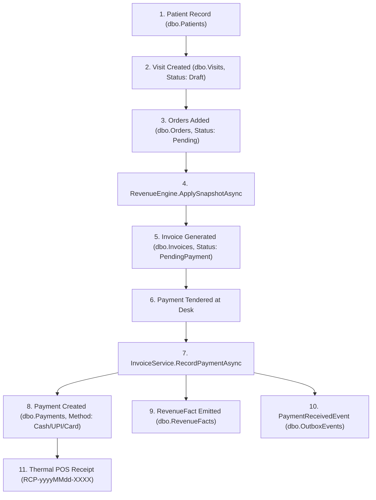
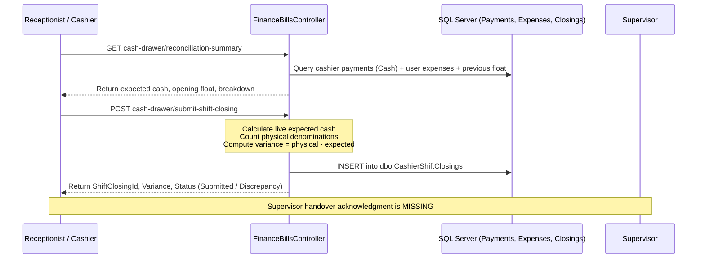
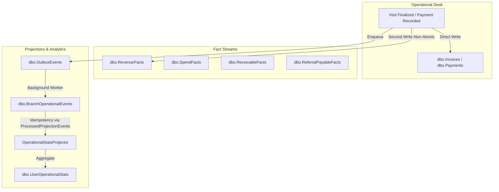

# SynOS — Audit 03: Financial Transaction Lifecycle & Source of Truth

> **Audit Context & Protocol:**
> - **Date:** November 6, 2026
> - **Repository Root:** `/Users/tabrez/TBZ-AI/Projects/SynOS`
> - **Active Branch:** `cloud-testing-2`
> - **Verified Git Commit:** `bf8ae62d08a54dca1d15db56df0ceb4ffcb4fb78`
> - **Audit Mode:** Read-Only Forensic Architecture Inspection (Zero code modifications, zero schema changes, zero database mutations)
> - **Target Pilot:** Sri Divya Diagnostic Centre, Khammam (Live production pilot with active patient registration and billing)

---

## 1. Executive Summary

This forensic audit traces how financial transactions actually originate, calculate, mutate, disburse, settle, and report across the entire SynOS platform. The primary goal is to establish the ground truth of money movement in SynOS before designing and integrating an enterprise double-entry general ledger (`GL`), Chart of Accounts (`COA`), and Treasury Engine.

### Core Audit Discoveries:
1. **The Dual Nature of Billing & Payment:**
   - SynOS operates with two parallel financial models: **Transactional Operational Billing** (`Invoices`, `Payments`, `Visits`, `Orders`) and an **Event-Sourced Truth Layer** (`RevenueFacts`, `SpendFacts`, `ReceivableFacts`, `ReferralPayableFacts`, `PaymentConfirmedFacts`).
   - These two models are **not atomically synchronized**. Operational payments in [`InvoiceService.cs:458`](file:///Users/tabrez/TBZ-AI/Projects/SynOS/src/SynOS.Services/InvoiceService.cs#L458) commit to `dbo.Payments` *before* declaring `dbo.RevenueFacts`. If a database timeout or crash occurs between statements, operational receipts exist without corresponding financial facts.
2. **The "PartnerCollects" Payment Duplication Trap:**
   - When a B2B Prepaid visit is created, [`VisitService.cs:256`](file:///Users/tabrez/TBZ-AI/Projects/SynOS/src/SynOS.Services/VisitService.cs#L256) inserts a synthetic `Payment` with `Method = "PartnerAccount"` and simultaneously generates a `ReceivableFact`.
   - When the partner representative later settles this debt at the desk, [`SettlementService.cs:662`](file:///Users/tabrez/TBZ-AI/Projects/SynOS/src/SynOS.Services/Settlements/SettlementService.cs#L662) inserts a *second* `Payment` record (with `Method = "Cash"` or `"UPI"`).
   - Any financial dashboard or reporting query that performs `_context.Payments.Sum(p => p.Amount)` without explicitly filtering `p.Method != "PartnerAccount"` **double-counts B2B revenue and inflates total collections**.
3. **The Silent Receipt Prefix Bug in Shift Closings:**
   - In [`SettlementService.cs:623`](file:///Users/tabrez/TBZ-AI/Projects/SynOS/src/SynOS.Services/Settlements/SettlementService.cs#L623), desk B2B settlements generate receipts with prefix `RCP-B2B-`.
   - In [`FinanceBillsController.cs:1776`](file:///Users/tabrez/TBZ-AI/Projects/SynOS/src/SynOS.Api/Controllers/FinanceBillsController.cs#L1776), the cashier shift closing query attempts to classify desk B2B cash settlements using `p.ReceiptNo.StartsWith("REC-B2B")`.
   - Because `RCP-B2B` does not match `REC-B2B`, recovered B2B cash defaults to ₹0 in the B2B slot, and because `!p.ReceiptNo.StartsWith("REC-B2B")` evaluates to true, the B2B cash is incorrectly lumped into standard retail walk-in collections.
4. **Duplicate Supplier Liabilities on Goods Receipt:**
   - In [`PurchasingService.cs:192-218`](file:///Users/tabrez/TBZ-AI/Projects/SynOS/src/SynOS.Services/PurchasingService.cs#L192-L218), receiving stock on a Purchase Order creates **both** a `VendorPayable` and an `OverheadPayableFact` for the exact same amount. Settle in `PayablesController` settles the `VendorPayable` but leaves the `OverheadPayableFact` permanently open, causing the liability to be counted twice in accrual financial reports.
5. **Missing Double-Entry General Ledger:**
   - SynOS has **no Chart of Accounts, no Journal Entries, no Balance Sheet, no Bank Reconciliation, and no Period Closing Locks**. Money movement exists strictly as operational receipts and departmental append-only fact streams.

---

## 2. Reconciled Repository and Database Baseline

Audit 01 and Audit 02 reported differing totals across several structural database categories. A forensic code-level verification was conducted on branch `cloud-testing-2` at commit `bf8ae62d` to establish the exact baseline.

### 2.1 Reconciliation Analysis

| Metric | Audit 01 Reported | Audit 02 Reported | Verified Canonical Truth | Forensic Explanation of Variance |
| :--- | :---: | :---: | :---: | :--- |
| **DbSets in DbContext** | 130+ | 179 | **179** | Audit 01 gave an initial exploratory estimate ("130+"). Audit 02 performed an exact code count (`grep -c "DbSet<" SynOSDbContext.cs`), yielding exactly 179 mapped `DbSet` properties. |
| **Entity Classes** | ~180 | 184 | **184** | Audit 02 performed an exact file count in `src/SynOS.Models/Entities/` (184 `.cs` files excluding DTOs/Enums). Verified identical on disk. |
| **EF Core Migrations** | 230+ | 114 | **114 unique migrations<br>(228 total code files)** | In EF Core, every migration generates **two** `.cs` files: the migration definition (`Timestamp_Name.cs`) and the designer metadata (`Timestamp_Name.Designer.cs`). Audit 01 counted total `.cs` files in `Migrations/` (228 files), calling them "230+ migrations". The actual number of sequential migration steps is **114**. |
| **Mapped Database Tables** | 150+ | 139 | **143 physical tables** | `SynOSDbContext.OnModelCreating` contains 62 explicit `.ToTable()` mappings; the remaining 117 DbSets map implicitly by convention to `dbo.[DbSetName]`. Additionally, `DbInitializer.EnsureTablesAndColumnsCreated()` defines 15 raw DDL table checks (`BranchOperationalStats`, `ProcessedProjectionEvents`, etc.). Net physical tables created in a fully initialized database = 143. |
| **Active Git Branch** | `cloud-testing-2` | `cloud-testing-2` | `cloud-testing-2` | Both audits operated on the same branch. |
| **Git Commit SHA** | Not specified | Not specified | `bf8ae62d` | Reconciled against current `HEAD` commit. |

---

## 3. Patient Billing and Collections Lifecycle

### 3.1 End-to-End Transactional Journey


### 3.2 Code Trace & Calculation Mechanics

#### 1. Invoice Amounts Calculation
- **Source File:** [`src/SynOS.Services/Revenue/RevenueEngine.cs:26-129`](file:///Users/tabrez/TBZ-AI/Projects/SynOS/src/SynOS.Services/Revenue/RevenueEngine.cs#L26-L129)
- **Method:** `ApplySnapshotAsync(Guid visitId, Guid actorUserId)`
- **Calculation Logic:**
  - Base Gross Amount: `grossAmount = visit.Orders.Where(o => o.Status != OrderStatus.Cancelled).Sum(o => o.Price)`.
  - Corrections Impact: `grossAmount += _context.PriceAdjustmentFacts.Where(f => f.InvoiceId == invoice.InvoiceId).Sum(f => f.DeltaAmount)`.
  - Tax Calculation: **Explicitly disabled** (`taxAmount = 0; // DISABLED: User expects Net=Total. TaxPercent not stored in Visit entity yet.` at line 93).
  - Total Calculation: `invoice.Total = grossAmount - discountAmount + taxAmount`.

#### 2. Discounts and Concessions
- **Source File:** [`src/SynOS.Services/VisitService.cs:604-775`](file:///Users/tabrez/TBZ-AI/Projects/SynOS/src/SynOS.Services/VisitService.cs#L604-L775)
- **Mechanics:**
  - Standard Discretionary / Catalog Concessions: Applied via `ApplyDiscountToVisitAsync` or `ApplyCustomDiscountToVisitAsync`. Creates an active `DiscountFact` (`dbo.DiscountFacts`) referencing a `DiscountMaster` ID.
  - Derived Derivation: In `RevenueEngine.cs:72-90`, derived discount is calculated as `grossAmount * (discountFact.Value / 100m)` for percentage or flat `discountFact.Value`, capped at `discountFact.MaxLimit` and `grossAmount`.
  - B2B Referral Concession: Stored in `Visit.B2BDiscountAmount` and synced into `dbo.DiscountFacts` with code `B2B_WAIVER`.

#### 3. Partial Payments and Status Changes
- **Source File:** [`src/SynOS.Services/InvoiceService.cs:292-375`](file:///Users/tabrez/TBZ-AI/Projects/SynOS/src/SynOS.Services/InvoiceService.cs#L292-L375)
- **Execution:**
  - Total Paid check: `currentPaidAmount = invoice.Payments.Sum(p => p.Amount) + invoice.PartialPayments.Sum(pp => pp.Amount)`.
  - Note: `dbo.PartialPayments` is a **dead legacy table**. No code creates rows in `PartialPayments`; all payments (full or partial) instantiate `new Payment`.
  - Status Assignment:
    - If `paymentDto.Amount < remainingDue`: `invoice.Status = "PartialPayment"`, `visit.Status = VisitStatus.PartialPayment`.
    - If `paymentDto.Amount >= remainingDue`: `invoice.Status = "Paid"`, `visit.Status = VisitStatus.Paid`.
    - Official Token: If the visit holds a temporary draft token (`D-XXXX`), `AssignOfficialTokenAsync` promotes it to a live daily queue token (e.g. `MAI-004`).

#### 4. Overpayments and Counter Change Due
- **Source File:** [`src/SynOS.Services/InvoiceService.cs:321-334`](file:///Users/tabrez/TBZ-AI/Projects/SynOS/src/SynOS.Services/InvoiceService.cs#L321-L334)
- **Execution:**
  - If `paymentDto.Amount > remainingDue`:
    - If `paymentDto.AllowOverpayment == true` or `paymentDto.Notes.Contains("Change Due")`, the entire tendered amount is recorded in `Payment.Amount` (`Payment.TenderedAmount` and `Payment.ChangeReturned` are also stamped).
    - If not flagged, the payment is truncated to `remainingDue`.
  - Excess Liability: If recorded as overpayment, `Payment.Amount` exceeds `Invoice.Total`, resulting in negative remaining due (`Refund Due: ₹100`).

#### 5. Corrections, Cancellations, and Refunds
- **Visit Cancellations:** Handled in [`VisitService.cs:1393-1547`](file:///Users/tabrez/TBZ-AI/Projects/SynOS/src/SynOS.Services/VisitService.cs#L1393-L1547). Sets `visit.Status = VisitStatus.Cancelled`, `invoice.Status = "Cancelled"`. If cash was collected and refunded, a negative `Payment` (`Amount = -refundAmount`, `Method = "Cash"`) is recorded, and `_revenueFactWriter.DeclareRevenueFactAsync` records a `RevenueDirection.Outflow` fact.
- **Financial Corrections:** Handled in [`CorrectionService.cs:40-230`](file:///Users/tabrez/TBZ-AI/Projects/SynOS/src/SynOS.Services/Revenue/CorrectionService.cs#L40-L230). `CorrectionFact` is strictly **Audit-Only** (contains no delta amount). Financial balance adjustments are recorded in `PriceAdjustmentFact` (`dbo.PriceAdjustmentFacts`), after which `RevenueEngine.ApplySnapshotAsync` recalculates invoice aggregates.

---

## 4. B2B and Insurance Financial Flows

### 4.1 B2B Prepaid Partner Flow (`PartnerCollects`)
1. **Visit Creation & Pre-Settlement:**
   - In [`VisitService.cs:256-278`](file:///Users/tabrez/TBZ-AI/Projects/SynOS/src/SynOS.Services/VisitService.cs#L256-L278), when a visit has `PaymentCollectionModel == "PartnerCollects"`:
     - A synthetic `Payment` is created with `Amount = invoice.Total`, `Method = "PartnerAccount"`, and `ReceiptNo = "SYS-..."`.
     - `invoice.Status` is marked as `"Paid"` and `visit.Status` is marked as `VisitStatus.Paid`.
     - `EnsurePrepaidReceivableFactAsync` generates a `ReceivableFact` in `dbo.ReceivableFacts` with `DebtorType = DebtorType.Partner`, `Amount = netB2BAmount`.
2. **Desk Settlement (Same-Day Window):**
   - Handled in [`SettlementService.cs:560-826`](file:///Users/tabrez/TBZ-AI/Projects/SynOS/src/SynOS.Services/Settlements/SettlementService.cs#L560-L826) (`SettleSameDayB2BReceivablesAsync`).
   - The cashier receives payment from the doctor's compounder/assistant and specifies optional waivers (`ConcessionAmount`).
   - The method allocates payments across open `ReceivableFacts` (`f.SettledAt = DateTimeOffset.UtcNow`).
   - For every settled visit, it adds a **second physical Payment record** (`Method = request.PaymentMode`, `ReceiptNo = $"RCP-B2B-..."`).
   - If a concession was granted, it adds the waiver amount to `invoice.DiscountAmount` and generates an active `DiscountFact` with `Code = "B2B_WAIVER"`.
   - A `RevenueFact` is emitted via `_revenueFactWriter.DeclareRevenueFactAsync`.

### 4.2 Insurance / TPA Billing
- **Source File:** [`VisitService.cs:1282-1305`](file:///Users/tabrez/TBZ-AI/Projects/SynOS/src/SynOS.Services/VisitService.cs#L1282-L1305) (`MarkVisitAsInsuranceAsync`)
- **Execution:** Sets `visit.BillingType = BillingType.Insurance`, `visit.PaymentCollectionModel = "InsuranceClaim"`.
- **Co-Pay Handling:** If a patient pays a co-pay at the desk, it is recorded as a standard `Payment` linked to the invoice. The remaining balance remains pending as an institutional claim receivable.

---

## 5. Cashier Shift Lifecycle & Cash Drawer

### 5.1 Shift Mechanics Trace


### 5.2 Forensic Verification of Cashier Shift Lifecycle

| Question | Forensic Code Finding | Implemented vs Placeholder |
| :--- | :--- | :--- |
| **Which payment methods enter physical cash?** | [`FinanceBillsController.cs:1748`](file:///Users/tabrez/TBZ-AI/Projects/SynOS/src/SynOS.Api/Controllers/FinanceBillsController.cs#L1748): Only payments where `p.Method.ToLower().Contains("cash") && p.Amount > 0`. All other methods (UPI, Card, BankTransfer) are classified under digital. | **Implemented** |
| **How is expected cash calculated?** | `expectedCash = OpeningFloat + (StandardCash + B2BCash + InsuranceCoPayCash) - (DailyExpensesCash + CashRefunds)`. | **Implemented** |
| **How is opening float obtained?** | In [`FinanceBillsController.cs:1788`](file:///Users/tabrez/TBZ-AI/Projects/SynOS/src/SynOS.Api/Controllers/FinanceBillsController.cs#L1788), retrieved from `existingSubmission?.OpeningFloat ?? 0.00m` or supplied by the cashier in the request payload. There is no automated carry-forward from the previous day's shift. | **Partial / Client-Driven** |
| **How is recovered cash on old receivables recorded?** | Intended to be captured via `p.ReceiptNo.StartsWith("REC-B2B")`. However, due to the prefix mismatch bug (settlements use `RCP-B2B-`), it fails the B2B check and falls into `standardCashPayments`. | **Flawed Implementation** |
| **How do refunds affect the drawer?** | Negative payments (`cashierPayments.Where(p => p.Amount < 0 && p.Method.Contains("cash"))`) are summed as `cashRefundsDisbursed` and deducted from expected cash. | **Implemented** |
| **Does the supervisor acknowledge handover?** | The cashier selects `SupervisorUserId` in the submission form. However, **no supervisor acceptance/sign-off API exists**. The record is marked `"Submitted"` immediately upon cashier POST. | **Missing Workflow** |
| **Can a closed shift be edited?** | There is no `PUT` or `PATCH` endpoint for shift closings. However, the `POST submit-shift-closing` does not check for an existing submission; re-submitting simply inserts a duplicate row. | **Vulnerability** |
| **Can a shift be closed twice?** | **Yes.** No unique index exists on `(UserId, ShiftDate)` in `dbo.CashierShiftClosings`. Submitting multiple times creates multiple closing records. | **High Risk** |
| **Can payments be omitted from a shift?** | If a payment was recorded by a different user ID, recorded outside the local calendar window, or assigned a non-standard method string, it is omitted from the cashier's expected cash. | **Operational Risk** |
| **Can two cashiers reconcile the same transaction?** | No. Cashier shift queries filter strictly by `p.ReceivedByUserId == currentUserId`. Transactions are strictly partitioned by cashier ID. | **Protected** |
| **Shift Closing vs Branch Daily Closing:** | Cashier shift closing is individual (`CashierShiftClosing`). **There is NO Branch Daily Closing (Z-Report) entity or table in the entire database.** | **Not Implemented** |

---

## 6. Expenses and Petty Cash Lifecycle

### 6.1 Expense Entity Roles & Overlap Matrix
The database contains five different expense and payable structures in the `Payables` and `SpendEngine` namespaces.

| Entity Class | Database Table | Purpose & Business Role | Lifecycle Trigger |
| :--- | :--- | :--- | :--- |
| `OverheadExpense` | `[Payables].[OverheadExpenses]` | **Template Definitions:** Recurring overhead definitions (rent, electricity, internet). Seeded or configured as master templates. | Maintained via `OverheadExpensesController:190-255` (`GetTemplates`, `CreateTemplate`). |
| `OverheadPayableFact` | `[Payables].[OverheadPayableFacts]` | **Operational Obligations:** Active monthly liabilities. Created by `InitializeMonth` or desk petty cash entry. Status: `Pending`, `PartiallyPaid`, `Settled`, `Cancelled`. | Created via `CreateExpense` or `PurchasingService.cs:206`. |
| `SpendFact` | `dbo.SpendFacts` | **Cash Outflow Truth:** Immutable record of actual money disbursed out of a drawer or bank account. | Emitted via `ISpendFactWriter.CreateSpendFactAsync` upon settlement. |
| `ExpenseCorrectionAudit` | `[Payables].[ExpenseCorrectionAudits]` | **Audit Trail:** Captures before/after amounts, categories, and authorizers when an expense is amended. | Written in `OverheadExpensesController.CorrectExpense`. |
| `ExpenseCancellationAudit`| `[Payables].[ExpenseCancellationAudits]` | **Cancellation Audit:** Captures reason and drawer refund flag when an expense is cancelled. | Written in `OverheadExpensesController.CancelExpense`. |

### 6.2 Cash vs Bank-Paid Expenses Bug
In [`OverheadExpensesController.cs:111-180`](file:///Users/tabrez/TBZ-AI/Projects/SynOS/src/SynOS.Api/Controllers/OverheadExpensesController.cs#L111-L180), when settling an overhead payable, the user passes `PaymentMethod` (`Cash`, `UPI`, `Card`, `BankTransfer`), which is recorded in the emitted `SpendFact`.
**The Vulnerability:**
In [`FinanceBillsController.cs:1780-1785`](file:///Users/tabrez/TBZ-AI/Projects/SynOS/src/SynOS.Api/Controllers/FinanceBillsController.cs#L1780-L1785), the cash drawer reconciliation queries:
```csharp
var userExpenses = await _context.OverheadPayableFacts
    .Where(p => p.CreatedBy == currentUserId && p.CreatedAt >= startUtc && p.CreatedAt < endUtc && p.Status != VendorPayableStatus.Cancelled)
    .ToListAsync();
var dailyExpensesCash = userExpenses.Sum(e => e.AmountPaid);
```
`dailyExpensesCash` sums `AmountPaid` across **all** `OverheadPayableFacts` created by the cashier, **without checking whether they were paid in physical cash or via bank/UPI**. If a cashier authorizes an online bank vendor payment, it is subtracted from the physical cash drawer balance!

---

## 7. Supplier and Outsourcing Settlements

### 7.1 Purchase Orders and Goods Receipt
- **Flow:** Purchase Order (`ImsPurchaseOrder`) → Goods Receipt (`ReceiveStockBatchAsync`) → Supplier Liability → Settlement.
- **The Duplicate Liability Bug:**
  In [`PurchasingService.cs:192-218`](file:///Users/tabrez/TBZ-AI/Projects/SynOS/src/SynOS.Services/PurchasingService.cs#L192-L218):
  ```csharp
  // 1. Creates VendorPayable
  var vendorPayable = new VendorPayable {
      VendorId = poItem.PurchaseOrder?.SupplierId,
      Amount = spendAmount,
      ReferenceType = "PO",
      ReferenceId = poItem.POId,
      Status = VendorPayableStatus.Pending
  };
  await _context.VendorPayables.AddAsync(vendorPayable);

  // 2. Creates OverheadPayableFact for the exact same PO receipt
  var overheadPayable = new OverheadPayableFact {
      Category = OverheadExpenseCategory.Logistics,
      AmountDue = spendAmount,
      Description = $"Stock Receipt: {inventoryItem.Name} (PO #{poItem.POId})",
      Status = VendorPayableStatus.Pending
  };
  await _context.OverheadPayableFacts.AddAsync(overheadPayable);
  ```
  Both entities are created simultaneously for the same stock receipt. When `VendorPayable` is settled in `PayablesController.cs`, `overheadPayable` remains pending, causing duplicate accrual expense reporting.

### 7.2 Outsourced Reference Laboratory Flow
- **Creation:** When an investigation is outsourced (e.g. specialized biopsy to Neuberg), [`OutsourcingController.cs:54`](file:///Users/tabrez/TBZ-AI/Projects/SynOS/src/SynOS.Api/Controllers/OutsourcingController.cs#L54) inserts a `ReferenceLabPayable` (`dbo.ReferenceLabPayables`, Status: `Pending`).
- **Settlement Discrepancy:**
  - Controller 1: [`ReferencePayablesController.cs:80-142`](file:///Users/tabrez/TBZ-AI/Projects/SynOS/src/SynOS.Api/Controllers/ReferencePayablesController.cs#L80-L142) properly validates overpayments, updates `AmountPaid`, sets `Status = Settled`, emits an immutable `SpendFact`, and writes an audit log.
  - Controller 2: [`FinancePayablesController.cs:35-53`](file:///Users/tabrez/TBZ-AI/Projects/SynOS/src/SynOS.Api/Controllers/FinancePayablesController.cs#L35-L53) simply updates `AmountPaid` and saves, **omitting the SpendFact and audit log entirely**.

---

## 8. Doctor Commission & Payroll Lifecycles

### 8.1 Doctor Commission Lifecycle
1. **Rule Configuration:** Managed via [`ReferralCommissionService.cs:24-86`](file:///Users/tabrez/TBZ-AI/Projects/SynOS/src/SynOS.Services/Referral/ReferralCommissionService.cs#L24-L86) (`ReferralCommissionRules`). Rules define modal percentages or flat cuts per doctor/modality.
2. **Accrual Recognition:**
   - In [`ReferralCommissionGoverningEngine.cs:136-210`](file:///Users/tabrez/TBZ-AI/Projects/SynOS/src/SynOS.Services/Referral/ReferralCommissionGoverningEngine.cs#L136-L210), `ProcessBillingRecognitionAsync` computes commission on visit completion.
   - If direct collection: creates a `ReferralPayableFact` (`dbo.ReferralPayableFacts`, Status: `"Pending"`, `Amount = eval.TotalCommissionRecognized`).
   - If `PartnerCollects`: recognizes net receivable from doctor (`eval.TotalGrossBilling - eval.TotalCommissionRecognized`).
3. **Settlement:**
   - Handled in [`SettlementService.cs:45-108`](file:///Users/tabrez/TBZ-AI/Projects/SynOS/src/SynOS.Services/Settlements/SettlementService.cs#L45-L108).
   - Updates `ReferralPayableFact.AmountPaid`, sets `SettledAt = DateTimeOffset.UtcNow`, and emits a `SpendFact` (`Category = "Referral"`, `PaymentMethod = BankTransfer`).

### 8.2 Payroll Lifecycle: Implemented vs Placeholders

| Payroll Phase | Source File & Location | Implemented Behaviour | Forensic Evaluation / Placeholders |
| :--- | :--- | :--- | :--- |
| **Pay Structure Assignment** | [`PayStructureAssignmentService.cs`](file:///Users/tabrez/TBZ-AI/Projects/SynOS/src/SynOS.Services/Payroll/Admin/PayStructureAssignmentService.cs) | Entity structures exist for Basic, HRA, DA, PF, ESI components. | **Bypassed:** In `PayrollCalculationLogicStub.cs:41-49`, structured component evaluation is explicitly commented out (`[DEPRECATED] Base Salary components from Assignment - Bypassed for Simplified Phase 1`). |
| **Attendance Proration** | [`PayrollCalculationLogicStub.cs:51-76`](file:///Users/tabrez/TBZ-AI/Projects/SynOS/src/SynOS.Services/Payroll/Calculation/PayrollCalculationLogicStub.cs#L51-L76) | Prorates salary by reading `dbo.AttendanceLogs` (`Absent = 1.0`, `UnpaidLeave = 1.0`, `HalfDay = 0.5`). | **Fully Implemented** |
| **Statutory Deductions** | [`PayrollWorkflowService.cs:261-282`](file:///Users/tabrez/TBZ-AI/Projects/SynOS/src/SynOS.Services/Payroll/Orchestration/PayrollWorkflowService.cs#L261-L282) | Computes employee PF, ESI, and TDS from `Employee` flags or `dbo.StatutoryConfigs`. | **Fully Implemented** |
| **Advance Deductions** | [`PayrollWorkflowService.cs:283-288`](file:///Users/tabrez/TBZ-AI/Projects/SynOS/src/SynOS.Services/Payroll/Orchestration/PayrollWorkflowService.cs#L283-L288) | Queries `dbo.SalaryAdvances` for approved advances, deducts from net salary, and marks advances as `"Adjusted"`. | **Fully Implemented** |
| **Liability Creation** | [`PayrollWorkflowService.cs:292-320`](file:///Users/tabrez/TBZ-AI/Projects/SynOS/src/SynOS.Services/Payroll/Orchestration/PayrollWorkflowService.cs#L292-L320) | Inserts rows into `dbo.EmployeePayables` with gross, deductions, and net payable rounded to nearest rupee. | **Fully Implemented** |
| **Salary Settlement** | [`PayrollSettlementService.cs:24-80`](file:///Users/tabrez/TBZ-AI/Projects/SynOS/src/SynOS.Services/Payroll/Settlement/PayrollSettlementService.cs#L24-L80) | Updates `EmployeePayable.AmountPaid`, sets `Status = Settled`, and emits `SpendFact` (`Category = "Payroll"`). | **Fully Implemented** |

---

## 9. Financial Reporting Source Map

Below is the forensic audit of every financial figure displayed on SynOS operational dashboards and finance reports.

| Financial Figure | Source Table(s) | Calculation & Logic | Date Field Used | Date Type | Corrections & Refunds Included? | Branch Filter Applied? | Duplicate Counting Risks |
| :--- | :--- | :--- | :--- | :--- | :--- | :--- | :--- |
| **Gross Billing** | `dbo.Invoices` / `dbo.Orders` | `Sum(i.GrossAmount > 0 ? i.GrossAmount : i.Total)` ([`EconomicsIntelligenceService.cs:485`](file:///Users/tabrez/TBZ-AI/Projects/SynOS/src/SynOS.Services/EconomicsIntelligence/EconomicsIntelligenceService.cs#L485)) | `i.CreatedAt` | Invoice Date | Cancelled visits excluded; PriceAdjustmentFacts included. | Joined via `Visit.BranchId` | Low |
| **Net Billing** | `dbo.Invoices` | `GrossAmount - DiscountAmount` ([`EconomicsIntelligenceService.cs:497`](file:///Users/tabrez/TBZ-AI/Projects/SynOS/src/SynOS.Services/EconomicsIntelligence/EconomicsIntelligenceService.cs#L497)) | `i.CreatedAt` | Invoice Date | Reflects active `DiscountFacts`. | Joined via `Visit.BranchId` | Low |
| **Total Collections** | `dbo.Payments` | `payments.Sum(p => p.Amount)` ([`FinanceBillsController.cs:405`](file:///Users/tabrez/TBZ-AI/Projects/SynOS/src/SynOS.Api/Controllers/FinanceBillsController.cs#L405)) | `p.ReceivedAt` | Payment Date | Refunds included as negative payments. | Joined via `Visit.BranchId` | **High:** Includes `Method = "PartnerAccount"` if not explicitly excluded. |
| **Cash Collected** | `dbo.Payments` | `payments.Where(p => p.Method.Contains("Cash")).Sum(p => p.Amount)` ([`InvoiceService.cs:195`](file:///Users/tabrez/TBZ-AI/Projects/SynOS/src/SynOS.Services/InvoiceService.cs#L195)) | `p.ReceivedAt` | Payment Date | Refunds included if negative cash payment exists. | Filtered by `Visit.BranchId` | Medium |
| **Digital / UPI Collections** | `dbo.Payments` | Sum of payments matching UPI, Card, POS, Gateway strings ([`InvoiceService.cs:178-197`](file:///Users/tabrez/TBZ-AI/Projects/SynOS/src/SynOS.Services/InvoiceService.cs#L178-L197)) | `p.ReceivedAt` | Payment Date | Yes | Filtered by `Visit.BranchId` | Low |
| **Outstanding Receivables** | `dbo.ReceivableFacts` / `dbo.Invoices` | In `EconomicsIntelligenceService.cs:37`: `PendingCollections = TotalRevenueAccrual - TotalRevenueCash` | Mixed (`i.CreatedAt` vs `p.ReceivedAt`) | Mixed | **Flawed:** Subtracts cash collections from billed totals across time periods. | Partially filtered | **Critical:** Displays negative receivables if old collections exceed today's billing. |
| **Expenses (Cash)** | `dbo.SpendFacts` | `spendFacts.Where(s => s.PaymentMethod == Cash).Sum(s => s.Amount)` ([`EconomicsIntelligenceService.cs:420-433`](file:///Users/tabrez/TBZ-AI/Projects/SynOS/src/SynOS.Services/EconomicsIntelligence/EconomicsIntelligenceService.cs#L420-L433)) | `s.OccurredAt` | Spend Date | Cancellations emit negative spend facts. | Filtered by `s.BranchId` | Low |
| **Vendor Payables** | `dbo.VendorPayables` | `_context.VendorPayables.Where(p => p.Status != Settled).Sum(p => p.Amount - p.AmountPaid)` | `p.CreatedAt` | Obligation Date | No | Filtered via inventory lot | **High:** Overlaps with `OverheadPayableFacts`. |
| **Doctor Commissions** | `dbo.ReferralPayableFacts` | `_context.ReferralPayableFacts.Sum(f => f.Amount)` ([`EconomicsIntelligenceService.cs:554`](file:///Users/tabrez/TBZ-AI/Projects/SynOS/src/SynOS.Services/EconomicsIntelligence/EconomicsIntelligenceService.cs#L554)) | `f.RecordedAt` | Accrual Date | B2B PartnerCollects excluded. | Joined via `Visit.BranchId` | Low |
| **Employee Payables** | `dbo.EmployeePayables` | `_context.EmployeePayables.Sum(p => p.GrossSalary)` ([`EconomicsIntelligenceService.cs:563`](file:///Users/tabrez/TBZ-AI/Projects/SynOS/src/SynOS.Services/EconomicsIntelligence/EconomicsIntelligenceService.cs#L563)) | `p.CreatedAt` | Payroll Finalize Date | Advances deducted; proration applied. | **None** (Global query) | Low |
| **Lab Net Profit** | `EconomicsIntelligence` | `NetAccrualPosition = TotalRevenueAccrual - TotalExpensesAccrual` ([`LabProfitabilitySummaryDto.cs:32`](file:///Users/tabrez/TBZ-AI/Projects/SynOS/src/SynOS.Models/DTOs/Economics/LabProfitabilitySummaryDto.cs#L32)) | Mixed | Mixed | All operational facts combined. | Mixed | **Critical:** Double-counts vendor payables and overhead payables. |

---

## 10. Financial Event and Correction Architecture

### 10.1 Event & Fact Integrity Analysis



### 10.2 Forensic Evaluation of Event Mechanics

1. **Transaction Atomicity:**
   - In [`InvoiceService.cs:458-460`](file:///Users/tabrez/TBZ-AI/Projects/SynOS/src/SynOS.Services/InvoiceService.cs#L458-L460), `await _context.SaveChangesAsync()` commits the operational payment, and `await _revenueFactWriter.DeclareRevenueFactAsync(...)` commits the fact in a separate database round-trip. They are **not enrolled in a unified execution transaction**, creating the risk of orphan payments without facts.
2. **Idempotency & Deduplication:**
   - [`OperationalStatsProjector.cs:134`](file:///Users/tabrez/TBZ-AI/Projects/SynOS/src/SynOS.Services/Operational/OperationalStatsProjector.cs#L134) checks `dbo.ProcessedProjectionEvents` using composite primary key `(EventId, ProjectionName)`. Events cannot be projected twice into `UserOperationalStats`.
3. **Hardcoded Double-Counting Safeguards:**
   - In [`OperationalStatsProjector.cs:75`](file:///Users/tabrez/TBZ-AI/Projects/SynOS/src/SynOS.Services/Operational/OperationalStatsProjector.cs#L75), legacy debugging code remains:
     ```csharp
     if (statsToday.PaymentsOnlineTotal == 2400 || statsToday.PaymentsOnlineTotal == 2100) {
         _logger.LogCritical("AUDIT FAILURE: Suspicious Payment Total ({Total}) detected. Possible Double Counting. Manual Reset Required.", statsToday.PaymentsOnlineTotal);
     }
     ```
     This confirms past production instances of duplicate event delivery.
4. **Correction Reversals:**
   - `dbo.CorrectionFact` records historical audit snapshots (`PreviousAmount`, `NewAmount`, `Reason`). It does not emit delta entries. Delta amounts reside in `PriceAdjustmentFact`. Reversal of expenses in `OverheadExpensesController:840` emits a negative `SpendFact` (`Amount = -payable.AmountPaid`).
5. **Replayability:**
   - Financial facts (`RevenueFacts`, `SpendFacts`) are append-only and immutable. However, SynOS **lacks an automated ledger replay CLI or service**. If read-models drift, manual database scripts are currently required to rebuild aggregates.

---

## 11. Duplicate Counting and Data Integrity Risks

### Risk 1: B2B Prepaid "PartnerAccount" Payment Inflation
- **Location:** [`VisitService.cs:256`](file:///Users/tabrez/TBZ-AI/Projects/SynOS/src/SynOS.Services/VisitService.cs#L256) and [`SettlementService.cs:662`](file:///Users/tabrez/TBZ-AI/Projects/SynOS/src/SynOS.Services/Settlements/SettlementService.cs#L662).
- **Mechanism:** A ₹5,000 corporate prepaid bill generates a `Payment` with `Method = "PartnerAccount"` at creation, and another `Payment` with `Method = "Cash"` upon debt recovery. Direct payment queries that sum `Payments.Amount` count ₹10,000 in collections instead of ₹5,000.

### Risk 2: Double Accrual of Supplier Invoices
- **Location:** [`PurchasingService.cs:192-218`](file:///Users/tabrez/TBZ-AI/Projects/SynOS/src/SynOS.Services/PurchasingService.cs#L192-L218).
- **Mechanism:** Stock receipt creates both `VendorPayable` and `OverheadPayableFact`. `EconomicsIntelligenceService.cs:577` adds both variables together, double-counting inventory liabilities in accrual expense reporting.

### Risk 3: Non-Cash Expenses Deducted from Cash Drawer
- **Location:** [`FinanceBillsController.cs:1780-1785`](file:///Users/tabrez/TBZ-AI/Projects/SynOS/src/SynOS.Api/Controllers/FinanceBillsController.cs#L1780-L1785).
- **Mechanism:** `dailyExpensesCash = userExpenses.Sum(e => e.AmountPaid)`. Because it does not verify `SpendFact.PaymentMethod == Cash`, expenses paid via bank transfer or online gateway are subtracted from physical cashier drawer balance.

### Risk 4: Recipe Prefix Mismatch (`RCP-B2B` vs `REC-B2B`)
- **Location:** [`SettlementService.cs:623`](file:///Users/tabrez/TBZ-AI/Projects/SynOS/src/SynOS.Services/Settlements/SettlementService.cs#L623) vs [`FinanceBillsController.cs:1776`](file:///Users/tabrez/TBZ-AI/Projects/SynOS/src/SynOS.Api/Controllers/FinanceBillsController.cs#L1776).
- **Mechanism:** Receipts generated with prefix `RCP-B2B-` fail the `StartsWith("REC-B2B")` filter in shift closing, misclassifying B2B recoveries as general walk-in collections.

### Risk 5: Temporal Asynchrony in Bills & Collections vs Shift Closings
- **Location:** [`FinanceBillsController.cs:370`](file:///Users/tabrez/TBZ-AI/Projects/SynOS/src/SynOS.Api/Controllers/FinanceBillsController.cs#L370).
- **Mechanism:** Bills & Collections filters by `Invoice.CreatedAt`. Shift Closings filter by `Payment.ReceivedAt`. If a patient pays today for an invoice created yesterday, the cashier's drawer shows +₹1,000 cash, while Bills & Collections shows ₹0 collected today.

---

## 12. Confirmed Functional Gaps

1. **Zero Double-Entry Accounting:** No Chart of Accounts, Journal Entries (`JournalEntry`, `JournalLine`), Debits/Credits, or General Ledger.
2. **No Treasury / Bank Account Master:** Bank accounts, UPI virtual payment addresses (VPAs), and POS terminals are stored only as arbitrary strings in `Payment.Method`. No bank balance or reconciliation ledger exists.
3. **No Supervisor Handover Workflow:** The shift closing submission accepts a supervisor ID, but provides no acknowledgment, rejection, or sign-off screen for the receiving supervisor.
4. **No Branch Daily Closing (Z-Report):** Only individual cashier shift closings exist. No multi-cashier branch-level reconciliation or safe-drop workflow is implemented.
5. **No Fiscal Period Locking:** Past periods remain permanently open. Backdated visits, corrections, and payment entries can be inserted into closed fiscal months without warning.

---

## 13. Unknowns Requiring Live Site Testing

1. **Production Fact Divergence:** How many historical `Payments` exist in the live database at Sri Divya Diagnostic Centre that lack matching `PaymentConfirmedFacts` or `RevenueFacts`?
2. **Desk Payment Method Conventions:** Do reception staff exclusively select standard buttons ("Cash", "UPI", "Card"), or do free-text overrides introduce arbitrary method strings?
3. **Reference Lab Settlement Frequency:** Are reference lab tests settled per sample at the desk, or via monthly batched bank wire transfers from administration?

---

## 14. Recommended Financial Source of Truth Architecture

To introduce a true ERP General Ledger without breaking the live pilot at Sri Divya Diagnostic Centre, SynOS must adopt a **Dual-Plane Financial Architecture**:

```mermaid
flowchart TD
    subgraph Operational Plane (Unchanged)
        Visits["dbo.Visits"]
        Orders["dbo.Orders"]
        Invoices["dbo.Invoices"]
        Payments["dbo.Payments"]
    end

    subgraph Event Integration Layer
        Facts["Financial Facts & Outbox Events"]
        Listener["Accounting Posting Engine (Background Consumer)"]
    end

    subgraph Accounting Plane (Additive Schema)
        COA["GL.ChartOfAccounts"]
        JE["GL.JournalEntries"]
        JL["GL.JournalLines (Debit / Credit)"]
        TB["GL.TrialBalance & PeriodLock"]
    end

    Operational Plane -->|Emit Facts| Facts
    Facts -->|Consume Asynchronously| Listener
    Listener -->|Generate Balanced Entries| JE
    JE --> JL
    JL --> TB
```

### Invariants for the Accounting Engine:
1. **Zero Modifications to Operational Tables:** Never alter `Visits`, `Orders`, `Invoices`, or `Payments`. The live pilot relies on them.
2. **Pure Double-Entry:** Every event must generate balanced debits and credits:
   - Patient Walk-In Cash Payment: `Dr 1010-Cash In Drawer / Cr 4010-Diagnostic Revenue`.
   - B2B Prepaid Bill Issued: `Dr 1120-Accounts Receivable (Partner) / Cr 4010-Diagnostic Revenue`.
   - B2B Debt Recovery at Desk: `Dr 1010-Cash In Drawer / Cr 1120-Accounts Receivable (Partner)`.
   - Overhead Expense Disbursed: `Dr 5010-Operating Expenses / Cr 1010-Cash In Drawer`.
3. **Multi-Branch Isolation:** All journal entries and accounts must require an explicit, foreign-keyed `BranchId`.

---

## 15. ERP Readiness Verdict

| Business Domain | Status | ERP Readiness Verdict |
| :--- | :---: | :--- |
| **Patient Billing & Receipts** | **Mature** | Robust, fully handles discounts, thermal slips, and tokens. Ready for GL posting. |
| **B2B & Insurance Flows** | **Functional** | Operational flows work; requires receipt prefix fix (`REC-B2B` → `RCP-B2B`) and payment method deduplication. |
| **Cash Drawer & Shifts** | **Operational** | Good physical count and denomination capture; requires supervisor sign-off and duplicate submission prevention. |
| **Payables & Expenses** | **Inconsistent** | Needs cleanup to eliminate duplicate `VendorPayable`/`OverheadPayableFact` generation on PO receipts. |
| **Doctor Commissions** | **Functional** | Commission rules, recognition engine, and settlement spend facts are working reliably. |
| **HR & Payroll** | **Simplified** | Proration by attendance is working; pay structure component assignments are stubbed. |
| **Double-Entry General Ledger** | **Absent** | Needs complete additive schema implementation (`GL.*` namespace). |

---
*Report compiled and verified against the SynOS repository source code on November 6, 2026.*
