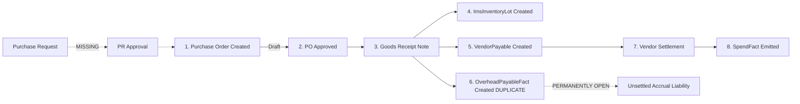
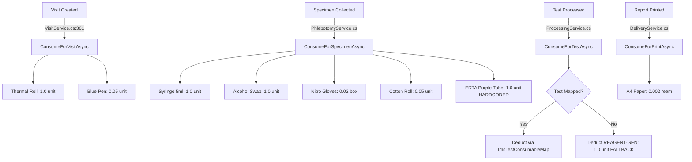
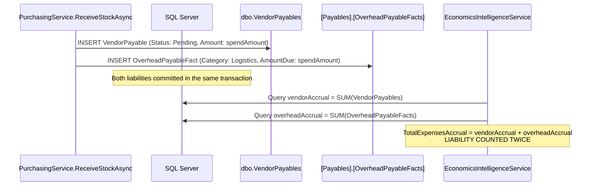

# SynOS — Audit 05: Procurement, Inventory & Material Cost Control

> **Audit Context & Protocol:**
> - **Date:** November 6, 2026
> - **Repository Root:** `/Users/tabrez/TBZ-AI/Projects/SynOS`
> - **Active Branch:** `cloud-testing-2`
> - **Verified Git Commit:** `bf8ae62d08a54dca1d15db56df0ceb4ffcb4fb78`
> - **Target Pilot Facility:** Sri Divya Diagnostic Centre, Khammam
> - **Audit Mode:** Read-Only Forensic Architecture & Data Integrity Audit (Zero code modifications, zero schema changes, zero database mutations)

---

## 1. Executive Summary

This forensic audit evaluates SynOS's procurement, supplier management, inventory control, and material cost attribution capabilities to determine whether the existing platform can reliably support supply chain operations as a Diagnostic Business ERP.

### Key Forensic Discoveries:

1. **The Core PO Architecture Was Built Solely for Specimen Tubes:**
   - In [`ImsPOItem.cs:18-20`](file:///Users/tabrez/TBZ-AI/Projects/SynOS/src/SynOS.Models/Entities/IMS/ImsPOItem.cs#L18-L20), the purchase order item entity contains an immutable database foreign key to `TubeId` (`ImsTubeMaster`).
   - To allow purchasing general reagents and consumables without breaking this constraint, [`PurchasingService.cs:83-96`](file:///Users/tabrez/TBZ-AI/Projects/SynOS/src/SynOS.Services/PurchasingService.cs#L83-L96) implements an **"auto-shadow" shim** that silently clones non-tube inventory items into `ImsTubeMasters` on-the-fly.
2. **Two Competing Goods Receipt & Payable Creation Paths:**
   - **Path A (`IMSPurchasingController` → `PurchasingService.ReceiveStockAsync`):** Requires a Purchase Order, creates an `ImsInventoryLot`, and **creates both a `VendorPayable` and an `OverheadPayableFact`**, causing the duplicate supplier liability defect identified in Audit 03 & 04.
   - **Path B (`InventoryController` → `InventoryService.ReceiveStockAsync`):** Allows receiving stock **without a purchase order** (`MANUAL-GRN`), creates an `ImsInventoryLot`, creates a `VendorPayable`, and does **not** create an `OverheadPayableFact`.
3. **Explicit Synthetic Negative Stock Accumulation:**
   - In [`ImsConsumptionService.cs:192-250`](file:///Users/tabrez/TBZ-AI/Projects/SynOS/src/SynOS.Services/Inventory/ImsConsumptionService.cs#L192-L250), when stock is depleted or untracked, clinical auto-consumption **does not block or warn**. Instead, it dynamically generates synthetic lots named `AUTO-NEG-yyyyMMdd` with **negative current quantities** and **₹0.00 unit costs**.
4. **Fractional vs. Integer Drift in Stock Movement Ledger:**
   - `ImsInventoryLot.CurrentQuantity` is a high-precision `decimal(18, 4)`.
   - `ImsStockMovement.Quantity` is a standard `int`.
   - When consuming fractional supplies (e.g. `0.05` of a pen or `0.002` ream of A4 paper), [`ImsConsumptionService.cs:182`](file:///Users/tabrez/TBZ-AI/Projects/SynOS/src/SynOS.Services/Inventory/ImsConsumptionService.cs#L182) applies `Math.Ceiling(deduct)`, recording an integer `1` in movements while subtracting `0.05` from the lot. Consequently, **historical stock movements can never mathematically reconcile with current stock balances**.
5. **No Stock Transfer, Purchase Return, or Physical Audit Features:**
   - SynOS has zero support for inter-branch stock transfers, debit notes, supplier returns, or physical inventory cycle counts. Damaged goods can only be logged as "Wastage," forcing the diagnostic centre to absorb supplier defects as operational losses.
6. **Incomplete Cost-Per-Test Attribution:**
   - The Economics Intelligence cost engine ([`EconomicsIntelligenceService.cs:117-180`](file:///Users/tabrez/TBZ-AI/Projects/SynOS/src/SynOS.Services/EconomicsIntelligence/EconomicsIntelligenceService.cs#L117-L180)) only reads `CostAttribution_UsageFacts`, which tracks blood collection tubes. **Chemical reagents, calibrators, quality controls, and analyzer cartridges are excluded from cost-per-test calculations.**

---

## 2. Supplier Management

### 2.1 Entity Inspection: `ImsSupplier`
- **Source File:** [`src/SynOS.Models/Entities/IMS/ImsSupplier.cs`](file:///Users/tabrez/TBZ-AI/Projects/SynOS/src/SynOS.Models/Entities/IMS/ImsSupplier.cs)
- **Database Table:** `dbo.IMS_Suppliers`
- **Schema Fields:** `SupplierId`, `Name`, `TaxId` (GST/VAT), `Category`, `Email`, `Phone`, `ContactInfo`, `IsActive`.
- **Unique Constraint:** Configured on `Name` in [`SynOSDbContext.cs:1259`](file:///Users/tabrez/TBZ-AI/Projects/SynOS/src/SynOS.Data/SynOSDbContext.cs#L1259).

### 2.2 Forensic Evaluation of Supplier Capabilities

| Supplier Capability | Implementation Status | Code & Database Evidence | Forensic Finding / Gap |
| :--- | :---: | :--- | :--- |
| **Supplier Master Records** | **Implemented** | [`ImsSupplier.cs`](file:///Users/tabrez/TBZ-AI/Projects/SynOS/src/SynOS.Models/Entities/IMS/ImsSupplier.cs), [`PurchasingService.cs:24`](file:///Users/tabrez/TBZ-AI/Projects/SynOS/src/SynOS.Services/PurchasingService.cs#L24) (`CreateSupplierAsync`). | Basic contact master exists with unique name constraint. |
| **Branch Ownership** | **Missing** | `ImsSupplier` has no `BranchId` column. | Suppliers are strictly global across all branches. Central procurement only; branches cannot maintain localized vendors independently. |
| **Payment Terms & Credit Periods** | **Missing** | No fields for payment terms (e.g. Net 30, Net 60, Advance) or credit limits. | Supplier liabilities default to arbitrary 30-day due dates hardcoded in [`PurchasingService.cs:212`](file:///Users/tabrez/TBZ-AI/Projects/SynOS/src/SynOS.Services/PurchasingService.cs#L212). |
| **Supplier Product Pricing / Contracts** | **Missing** | No supplier price lists or rate contracts exist. | Purchase order unit prices must be entered manually each time in `POItemCreateDto.UnitPrice`. |
| **Supplier Balances & Running Ledger** | **Partial / Disconnected** | Sourced via `_context.VendorPayables.Where(p => p.VendorId == id && p.Status != Settled)` in [`EconomicsIntelligenceService.cs:1367`](file:///Users/tabrez/TBZ-AI/Projects/SynOS/src/SynOS.Services/EconomicsIntelligence/EconomicsIntelligenceService.cs#L1367). | Balance is computed dynamically by summing unpaid `VendorPayables`. No running vendor balance ledger or statement of account exists. |
| **Activation / Deactivation** | **Implemented** | `ImsSupplier.IsActive` (boolean flag). | Soft deactivation supported; [`PurchasingService.cs:46`](file:///Users/tabrez/TBZ-AI/Projects/SynOS/src/SynOS.Services/PurchasingService.cs#L46) blocks PO creation for inactive suppliers. |

---

## 3. Procurement Lifecycle

### 3.1 End-to-End Workflow Trace


### 3.2 Stage-by-Stage Forensic Analysis

#### 1. Purchase Requisitions & Approvals
- **Status:** **Not Implemented for Suppliers.**
- **Evidence:** Staff can create internal departmental requests for existing stock via [`StockRequestController.cs`](file:///Users/tabrez/TBZ-AI/Projects/SynOS/src/SynOS.Api/Controllers/StockRequestController.cs). However, there is **no Purchase Requisition (PR) workflow** for procurement from external vendors. Procurement begins directly with a Purchase Order.

#### 2. Purchase Order Creation & Approval
- **Status:** **Implemented (Single-Step Draft → Approved).**
- **Source File:** [`PurchasingService.cs:44-128`](file:///Users/tabrez/TBZ-AI/Projects/SynOS/src/SynOS.Services/PurchasingService.cs#L44-L128)
- **Lifecycle:**
  - `CreatePurchaseOrderAsync`: Instantiates `ImsPurchaseOrder` (`Status = PurchaseOrderStatus.Draft`).
  - `AddPOItemAsync`: Adds line items. Validates that PO is in `Draft` status.
  - `ApprovePurchaseOrderAsync`: Sets `po.Status = PurchaseOrderStatus.Approved`.
- **Gaps:**
  - **No PO Amendments or Versioning:** Once items are added or approved, there is no method to amend line items, change quantities, or renegotiate prices.
  - **No PO Cancellation:** There is no `CancelPurchaseOrder` method in `PurchasingService` or `IMSPurchasingController`.
  - **No Approval Limits:** Any user authenticated with write permissions can approve purchase orders of arbitrary financial value without tiered delegation of authority.

#### 3. Goods Receipt & Partial Deliveries
- **Status:** **Implemented with Flaws.**
- **Source File:** [`PurchasingService.cs:130-224`](file:///Users/tabrez/TBZ-AI/Projects/SynOS/src/SynOS.Services/PurchasingService.cs#L130-L224)
- **Mechanics:**
  - Partial Deliveries Supported: `ReceiveStockAsync` validates that `poItem.ReceivedQuantity + dto.Quantity <= poItem.OrderedQuantity`.
  - Incremental Receipts: Each receipt creates a new `ImsInventoryLot` with the received batch number and expiry date.
- **Critical Defects:**
  - **PO Status Never Completes:** When all items on a PO are fully received, `ImsPurchaseOrder.Status` remains stuck in `Approved`. There is no check to transition the PO to `Received` or `Closed`.
  - **Zero Supplier Invoice Verification:** The receipt process records no supplier invoice number, invoice date, delivery challan reference, or GST tax invoice breakdown.
  - **Receipt Without PO Permitted:** Via [`InventoryService.cs:131`](file:///Users/tabrez/TBZ-AI/Projects/SynOS/src/SynOS.Services/Inventory/InventoryService.cs#L131), users can bypass the purchasing workflow entirely and receive stock into the branch under reference `MANUAL-GRN`.

#### 4. Rejections, Damaged Stock & Purchase Returns
- **Status:** **Missing.**
- **Evidence:** No entity exists for goods inspection notes, supplier return authorizations, debit notes, or credit adjustments. If reagents arrive damaged or warm (cold-chain failure), the system provides no way to reject them against the PO.

---

## 4. Inventory Management

### 4.1 Master Entity Architecture: The Three-Tier Model
SynOS maintains three overlapping entities to represent inventory:
1. **`ImsInventoryItem` (`dbo.IMS_InventoryItems`):** Abstract item identity (`ItemId`, `ItemCode`, `Name`, `ServiceArea`, `Modality`).
2. **`ImsConsumable` (`dbo.IMS_Consumables`):** Metadata entity (`ConsumableId`, `UnitOfMeasure`, `LowStockThreshold`, `Category`).
3. **`ImsTubeMaster` (`dbo.IMS_TubeMasters`):** Legacy entity retained solely to satisfy the `ImsPOItem.TubeId` foreign key constraint.

### 4.2 Forensic Inventory Audit Matrix

| Inventory Dimension | Implemented Status | Code Evidence | Forensic Finding / Operational Risk |
| :--- | :---: | :--- | :--- |
| **Branch Stock Ownership** | **Implemented** | `ImsInventoryLot.BranchId` foreign-keyed to `dbo.Branches`. | Stock is partitioned by branch at the lot level. |
| **Lots & Expiry Tracking** | **Implemented** | `ImsInventoryLot` tracks `BatchNumber`, `ExpiryDate`, `ContainerSize`, `CurrentQuantity`. | Near-expiry query supported in [`IMSStockReadController.cs:60`](file:///Users/tabrez/TBZ-AI/Projects/SynOS/src/SynOS.Api/Controllers/IMSStockReadController.cs#L60). |
| **Inter-Branch Stock Transfers** | **Missing** | Zero occurrences of stock transfer logic across all inventory services. | Reagents and tubes cannot be officially transferred between branches. |
| **Physical Stock Counts & Audits** | **Missing** | No cycle counting, physical verification, or variance adjustment screen. | Discrepancies between physical shelf stock and system stock cannot be adjusted through an audited stock take. |
| **Stock Adjustments** | **Defective** | `StockMovementType.Adjustment` is defined in enum but has **zero write operations** in the entire codebase. | Discrepancies cannot be adjusted. |
| **Wastage & Damage Logging** | **Partial** | [`IMSStockOperationController.cs:38`](file:///Users/tabrez/TBZ-AI/Projects/SynOS/src/SynOS.Api/Controllers/IMSStockOperationController.cs#L38) (`RecordWastage`). | Deducts quantity from `ImsTubeLot` and logs movement with `WastageReasonCode`. Operates only on legacy tube lots; general inventory items are unhandled. |
| **Negative Stock Prevention** | **Explicitly Disabled** | [`ImsConsumptionService.cs:192-250`](file:///Users/tabrez/TBZ-AI/Projects/SynOS/src/SynOS.Services/Inventory/ImsConsumptionService.cs#L192-L250). | Auto-consumption intentionally allows negative stock by spawning synthetic lots (`AUTO-NEG-yyyyMMdd`). |
| **Movement Ledger Reconciliation** | **Defective** | [`ImsConsumptionService.cs:182`](file:///Users/tabrez/TBZ-AI/Projects/SynOS/src/SynOS.Services/Inventory/ImsConsumptionService.cs#L182) (`Math.Ceiling(deduct)` stored as `int`). | Movements record integers; lots record decimals. Historical movements cannot reconcile with current stock balances. |

---

## 5. Laboratory Consumption Lifecycle

### 5.1 Auto-Consumption Mechanics Trace
Consumption in SynOS is automated across four clinical and administrative operational triggers:



### 5.2 Critical Forensic Findings on Consumption

#### Finding 5.1: Unrealistic Consumption Quantities & Hardcoded Assumptions
In [`ImsConsumptionService.cs:35-67`](file:///Users/tabrez/TBZ-AI/Projects/SynOS/src/SynOS.Services/Inventory/ImsConsumptionService.cs#L35-L67):
- **Thermal Receipt Roll:** Deducts `1.00m` full roll for every single patient registration! A 50-meter thermal roll serves approximately 250 receipts, yet the system deducts an entire roll per patient.
- **Hardcoded Purple EDTA Tube:** Every specimen collection automatically deducts `TUBE-EDTA` (Purple), even if the test is a Serum Biochemistry (requires Red/Gold SST tube), Coagulation (Blue Citrate), Fluoride Glucose (Grey), or a non-blood specimen (Urine/Sputum container).
- **Fallback Generic Reagent:** Any test without an explicit mapping in `dbo.ImsTestConsumableMaps` deducts 1 unit of `"REAGENT-GEN"`.

#### Finding 5.2: Zero Consumption Reversal on Visit or Test Cancellation
- In [`VisitService.cs:1393-1547`](file:///Users/tabrez/TBZ-AI/Projects/SynOS/src/SynOS.Services/VisitService.cs#L1393-L1547), cancelling a visit sets `visit.Status = Cancelled` and issues financial refunds.
- **`IImsConsumptionService` is never invoked during visit or order cancellation.**
- Consumables deducted at registration (receipt rolls, syringes, tubes) are permanently lost from system inventory even when the patient leaves without having samples drawn.

---

## 6. Inventory Valuation and Costing

### 6.1 Costing Method Inspection
- **Configured Setting:** [`LabProfile.InventoryValuationMethod`](file:///Users/tabrez/TBZ-AI/Projects/SynOS/src/SynOS.Models/Entities/LabProfile.cs#L113) defaults to `"FIFO"`.
- **Actual Code Reality:**
  - **No FIFO engine exists.**
  - In [`ImsConsumptionService.cs:163`](file:///Users/tabrez/TBZ-AI/Projects/SynOS/src/SynOS.Services/Inventory/ImsConsumptionService.cs#L163), stock lots are queried with `.OrderBy(l => l.ExpiryDate)`.
  - The physical consumption logic is **FEFO (First Expired, First Out)** based on manufacturer batch expiration, not accounting FIFO based on purchase order receipt dates.
  - The platform does not implement Weighted Average Costing or LIFO.

### 6.2 Valuation Limitations

| Valuation Dimension | Implementation State | Forensic Finding |
| :--- | :---: | :--- |
| **Historical Price Preservation** | **Partial** | `ImsInventoryLot.UnitCostSnapshot` captures PO unit price at receive time. However, auto-negative lots default to ₹0.00. |
| **Historical Valuation Reconstruction** | **Missing** | Current stock valuation is calculated on-the-fly (`CurrentQuantity * UnitCostSnapshot`). Because `ImsStockMovement` contains no unit cost and movements drift from lot decimals, **stock valuation cannot be reconstructed for any historical date**. |
| **Landed Cost Allocation** | **Missing** | Landed costs (freight, courier, cold-chain transport, customs) cannot be entered on POs or capitalized into inventory value. All purchases value stock strictly at base purchase price. |
| **Connection to Financial Statements** | **Missing** | Inventory value is not posted to any General Ledger asset account (`1200-Inventory Asset`). Cost of Goods Sold (COGS) is not debited when inventory is consumed. |

---

## 7. Procurement and Financial Integration

### 7.1 Deep Dive: The Duplicate Supplier Liability Defect
In Audit 03 and Audit 04, a severe liability duplication was identified on Purchase Order stock receipts.



### 7.2 Forensic Code Evidence:
In [`src/SynOS.Services/PurchasingService.cs:192-218`](file:///Users/tabrez/TBZ-AI/Projects/SynOS/src/SynOS.Services/PurchasingService.cs#L192-L218):
```csharp
// CREATE VENDOR PAYABLE (Phase 2)
var vendorPayable = new VendorPayable
{
    VendorPayableId = Guid.NewGuid(),
    VendorId = poItem.PurchaseOrder?.SupplierId,
    VendorName = poItem.PurchaseOrder?.Supplier?.Name,
    Amount = spendAmount,
    ReferenceType = "PO",
    ReferenceId = poItem.POId,
    Status = VendorPayableStatus.Pending,
    CreatedAt = DateTime.UtcNow
};
await _context.VendorPayables.AddAsync(vendorPayable);

// CREATE OVERHEAD PAYABLE FACT for Finance Expense Feed
var overheadPayable = new SynOS.Models.Entities.Payables.OverheadPayableFact
{
    OverheadPayableId = Guid.NewGuid(),
    Category = SynOS.Models.Enums.Payables.OverheadExpenseCategory.Logistics,
    AmountDue = spendAmount,
    Description = $"Stock Receipt: {inventoryItem.Name} (PO #{poItem.POId.ToString().Substring(0, 8)}) - {poItem.PurchaseOrder?.Supplier?.Name ?? "Supplier"}",
    DueDate = DateTime.UtcNow.AddDays(30),
    Status = VendorPayableStatus.Pending,
    CreatedAt = DateTime.UtcNow,
    CreatedBy = userId
};
await _context.OverheadPayableFacts.AddAsync(overheadPayable);
```

### 7.3 Financial Consequences:
1. **Double Obligation:** Every stock receipt creates two separate payable IDs with identical rupee values.
2. **Settlement Deadlock:** When finance settles the supplier bill in [`PayablesController.cs:75`](file:///Users/tabrez/TBZ-AI/Projects/SynOS/src/SynOS.Api/Controllers/PayablesController.cs#L75), `VendorPayable.Status` is marked `Settled`, but `OverheadPayableFact` remains permanently `Pending`.
3. **Double-Counted Expenses:** In [`EconomicsIntelligenceService.cs:577`](file:///Users/tabrez/TBZ-AI/Projects/SynOS/src/SynOS.Services/EconomicsIntelligence/EconomicsIntelligenceService.cs#L577):
   ```csharp
   summary.TotalExpensesAccrual = vendorAccrual + overheadAccrual + outsourcedAccrual + referralAccrual + payrollAccrual;
   ```
   Both `vendorAccrual` and `overheadAccrual` are summed, inflating accrual expenses by 100% of received stock value.

---

## 8. Branch-Level Inventory Control

### 8.1 Partitioning & Isolation Analysis

| Dimension | Global vs. Branch-Specific | Isolation Mechanism | Forensic Evaluation |
| :--- | :--- | :--- | :--- |
| **Supplier Master** | **Global** | No `BranchId` column. | Suppliers are accessible to all branches. Central procurement only. |
| **Item Catalog** | **Global** | No `BranchId` column. | Catalog is standardized globally across all branches. |
| **Stock Lots** | **Branch-Specific** | `ImsInventoryLot.BranchId` column. | Lots are strictly partitioned by branch. |
| **Auto-Consumption** | **Branch-Specific** | Filtered by `visit.BranchId`. | Consumption deducts strictly from the branch where the visit occurred. |
| **Staff Requisitions** | **Branch-Specific** | `ImsStockRequest.BranchId` column. | Requests are routed to the specific branch's inventory lots. |
| **Stock Valuation** | **Branch-Specific** | Filtered by `lot.BranchId`. | Supported in `GetStockLedgerAsync(branchId)`. |

### 8.2 Cross-Branch Vulnerability:
While lots carry a `BranchId`, [`PurchasingService.ReceiveStockAsync`](file:///Users/tabrez/TBZ-AI/Projects/SynOS/src/SynOS.Services/PurchasingService.cs#L130) accepts `dto.BranchId` from the client without verifying whether the purchasing user has authorized inventory receipt rights for that specific branch. A user from Branch A can receive PO stock into Branch B.

---

## 9. Inventory Reporting Inventory

A forensic review of the source tables and calculations used across inventory dashboards and economics reports:

| Report Metric | Source Table(s) | Calculation Logic | Forensic Integrity Assessment |
| :--- | :--- | :--- | :--- |
| **Current Stock Quantity** | `dbo.IMS_InventoryLots` | `Sum(l.CurrentQuantity)` grouped by `ItemId` ([`InventoryService.cs:52`](file:///Users/tabrez/TBZ-AI/Projects/SynOS/src/SynOS.Services/Inventory/InventoryService.cs#L52)) | **Accurate** to lot balances. Distorted by synthetic negative lots (`AUTO-NEG-`). |
| **Stock Valuation** | `dbo.IMS_InventoryLots` | `Sum(l.CurrentQuantity * l.UnitCostSnapshot)` | **Flawed:** Treats negative lots as ₹0.00; omits landed costs. |
| **Low-Stock Alerts** | `dbo.IMS_InventoryLots` + `dbo.IMS_Consumables` | `TotalQuantity <= LowStockThreshold` ([`InventoryService.cs:60`](file:///Users/tabrez/TBZ-AI/Projects/SynOS/src/SynOS.Services/Inventory/InventoryService.cs#L60)) | **Operational:** Alerts correctly when stock reaches threshold. |
| **Expiring Stock** | `dbo.IMS_TubeLots` / `dbo.IMS_InventoryLots` | `ExpiryDate <= DateTime.UtcNow.AddDays(days)` | **Fragmented:** Split across two separate controllers querying different lot tables. |
| **Consumption by Test** | `CostAttribution_UsageFacts` | `Sum(f.Quantity * f.UnitCost)` ([`EconomicsIntelligenceService.cs:168`](file:///Users/tabrez/TBZ-AI/Projects/SynOS/src/SynOS.Services/EconomicsIntelligence/EconomicsIntelligenceService.cs#L168)) | **Incomplete:** Only captures specimen collection tubes; omits all reagents and contrast media. |
| **Supplier Balances** | `[Payables].[VendorPayables]` | `Sum(p.Amount - p.AmountPaid)` grouped by `VendorId` | **Accurate** to PO liabilities, but detached from `OverheadPayableFacts`. |
| **Inventory Turnover** | *None* | *Not Calculated* | **Not Implemented.** |

---

## 10. Operational Readiness Verdict

### Can SynOS Reliably Manage Procurement, Inventory, and Material Costs as an Enterprise ERP?

### **VERDICT: PARTIALLY FUNCTIONAL OPERATIONAL CORE — NOT READY FOR FINANCIAL ERP.**

### Summary of What Works:
- Basic supplier catalog with active/inactive management.
- Purchase order generation and line-item approval.
- Incremental goods receipt with batch number and expiry date capture.
- Automated phlebotomy and test consumption hooks.
- Branch-level lot partitioning and near-expiry alerts.

### Confirmed Blockers for ERP Deployment:
1. **Duplicate Supplier Liability:** PO receipts create both `VendorPayables` and `OverheadPayableFacts`, double-counting supplier debt in accrual reporting.
2. **Integer Truncation in Movement History:** Storing decimal consumption as integers in `ImsStockMovement` prevents stock balance reconciliation.
3. **Synthetic Negative Stock:** Clinical workflows silently create negative lots at ₹0.00 instead of alerting staff or triggering emergency replenishment.
4. **Zero PO Amendments or Purchase Returns:** Defective or damaged stock cannot be returned, and supplier debit notes cannot be issued.
5. **No Inter-Branch Transfers:** Inventory cannot be transferred between main and peripheral collection branches.
6. **Reagents Omitted from Test Costing:** Material cost per test only includes collection tubes, rendering gross profit calculations misleading.

### Recommended Correction Direction:
- Remove lines 205-218 of `PurchasingService.cs` to eliminate duplicate `OverheadPayableFact` creation.
- Alter `ImsStockMovement.Quantity` to `decimal(18, 4)` and store `UnitCost` on movements.
- Replace `"AUTO-NEG-"` synthetic lots with a configurable "Allow Negative Stock" flag that retains the item's standard cost.
- Implement an explicit `DebitNote` / `PurchaseReturn` entity linked to `VendorPayables`.
- Expand `CostAttributionUsageFactWriter` to record reagent consumption from `ImsConsumptionService`.

---
*Report compiled and verified against the SynOS repository source code on November 6, 2026.*
