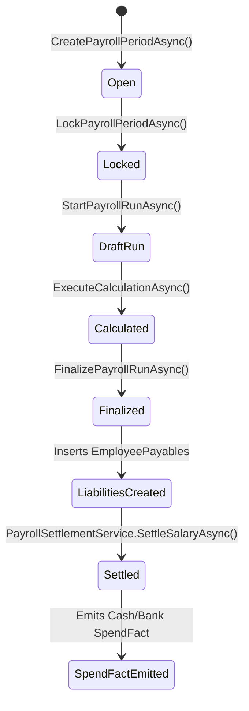

# SYNOS AUDIT 06: HR, PAYROLL & WORKFORCE MANAGEMENT
**System-Wide Diagnostic ERP Readiness Assessment**
**Pilot Facility:** Sri Divya Diagnostic Centre, Wyra Road, Khammam  
**Repository Snapshot:** `/Users/tabrez/TBZ-AI/Projects/SynOS` | Branch: `cloud-testing-2` | Commit: `bf8ae62d12564b1644e44728cd13f2e067e1186e`  
**Date of Audit:** November 6, 2026  
**Auditor:** DeepMind Advanced Agentic Coding (Forensic Systems Architecture & Accounting Specialist)

---

## 1. Executive Summary

Audit 06 evaluated whether the Human Resources, Time & Attendance, Leave Management, and Payroll systems of SynOS are capable of operating as an integrated, multi-branch workforce management and financial compensation ERP.

### Key Verdict
**Status: FUNCTIONAL STANDALONE PROVISIONAL ENGINE / NOT ERP-READY FOR ENTERPRISE WORKFORCE**

While SynOS possesses operational HR and Payroll capabilities—including employee master CRUD, exception-based attendance tracking, leave requests, a proration engine, liability generation (`EmployeePayables`), and cash/bank disbursement logging (`SpendFact`)—it operates on a **simplified single-facility bypass model** that deviates significantly from standard ERP and Indian statutory payroll principles.

### Critical Forensic Discoveries
1. **Multi-Branch HR Disconnection**: The `Employee` master (`dbo.Employees`) lacks a `BranchId` column. An employee is assigned to a department (`DepartmentId`), but branch residency is neither stored on the employee nor linked during user provisioning in `EmployeeAdminService.cs`. Multi-branch staff or branch-specific staff rosters cannot be natively isolated.
2. **Salary Structure Bypassed (`PayrollCalculationLogicStub.cs`)**: Enterprise pay components (Basic, HRA, Conveyance, Allowances in `dbo.PayStructureAssignments`) were explicitly commented out and bypassed for a flat `BaseSalary` model.
3. **Statutory Calculation Inversion**: Statutory PF (12%) and ESI (0.75%) deductions are calculated on the net prorated take-home base instead of qualifying gross wage bases, violating EPFO and ESIC rules.
4. **Attendance by Assumption**: Attendance calculation is exception-driven rather than presence-driven. An employee with zero check-ins and zero exceptions logged receives 100% full monthly compensation.
5. **Accrual Accounting Failure**: Payroll finalization creates liabilities (`EmployeePayable`), but does not emit expense facts to the financial engine until actual salary disbursement. Furthermore, when salaries are settled in `PayrollSettlementService.cs`, the generated `SpendFact` hardcodes `BranchId = Guid.Empty`, completely disconnecting labor expenses from branch P&L reporting.
6. **Zero Maker-Checker Security**: The `PayrollController.cs` endpoints lack authorization attribute guards and do not enforce segregation of duties; an administrative user can create, calculate, approve, finalize, and disburse their own salary without multi-party verification.

---

## 2. Employee Master Management

### Master Record Architecture
Employee master records are defined in `src/SynOS.Models/Entities/HR/Employee.cs` and mapped to database table `dbo.Employees`:
- **Primary Key**: `EmployeeId` (`Guid`, PK)
- **Names & Identity**: `FirstName`, `LastName`, `Email`, `Phone`, `EmergencyContact`, `PanNumber`, `AadhaarNumber`
- **Classification**: `EmploymentType` (`Permanent`, `Contract`, `Intern`, `VisitingDoctor`), `SalaryType` (`Monthly`, `Daily`, `PerTest`), `JobTitle`, `DepartmentId` (`Guid`, FK to `dbo.DepartmentMaster`), legacy `Department` (`nvarchar(max)`)
- **Compensation Metadata**: `BaseSalary` (`decimal(18,2)`), `BankName`, `AccountNumber`, `IFSC`
- **Statutory Toggles**: `PFEnabled` (default `true`), `PFPercentage` (default `12.0000`), `ESIEnabled` (default `true`), `ESIPercentage` (default `0.7500`), `TDSEnabled` (default `false`), `TDSMode` (`Fixed` vs `Percentage`), `TDSValue`
- **Leave Quota**: `MonthlyPaidLeaveQuota` (int, default `2`), `PreferredOffDay`
- **Status & Lifecyle**: `JoinDate` (`datetimeoffset`), `IsActive` (`bit`)
- **System Link**: `UserId` (`Guid`, nullable FK to `dbo.Users`)

### Findings & Architecture Gaps
1. **Absence of Branch Ownership**:
   - `dbo.Employees` has no `BranchId` foreign key. In a multi-branch diagnostic chain (e.g., Khammam Main Lab, Wyra Road Collection Centre, Madhira Branch), employees exist globally.
   - When `EmployeeAdminService.ProvisionUserFromEmployeeAsync()` creates a system user account (`dbo.Users`), it populates `dbo.UserRoles` but completely omits branch assignments in `dbo.UserBranchRoles`. Consequently, newly provisioned employees default to floating or single-branch fallbacks.
2. **Single Department Limitation**:
   - An employee can only link to one `DepartmentId`. Multi-department diagnostic personnel (e.g., a biochemist who also supervises sample triage in clinical pathology) cannot be represented across departmental hierarchies.
3. **No Reporting Hierarchy**:
   - There is no `ManagerId` or `ReportingSupervisorId` column on `Employee.cs`. Organizational hierarchy, escalation trees, and managerial leave approvals cannot be resolved through the employee master.
4. **Duplicate Prevention**:
   - `EmployeeAdminService.cs` does not enforce uniqueness constraints on PAN, Aadhaar, Phone, or Account Number. Multiple employee records can be created with identical banking or national identity identifiers.

---

## 3. Attendance Management

### Technical Implementation
Attendance tracking is implemented in:
- Entity: `src/SynOS.Models/Entities/Time/AttendanceLog.cs` (`dbo.AttendanceLogs`)
- Endpoints: `src/SynOS.Api/Controllers/AttendanceController.cs`
- Interpretation Service: `src/SynOS.Services/HRMS/Interpretation/HrmsInterpretationService.cs`
- Daily Exception Modal: `src/SynOS.Frontend/src/features/finance/components/workforce/AttendanceExceptionModal.jsx`

### Daily Tracking & Biometric Reality
1. **Clock-In / Clock-Out Flow**:
   - `AttendanceLog` contains `AttendanceLogId`, `EmployeeId`, `ClockIn` (`DateTime`), `ClockOut` (`DateTime?`), `Status` (`varchar`), and `Notes`.
   - **No Automated Biometric Hardware Driver**: SynOS has no integrated hardware listener (unlike the laboratory analyzer TCP listeners) for ZKTeco, Essl, or Matrix biometric devices. Attendance entries in the live pilot are entered via UI modals or imported.
2. **Exception-Driven Attendance Architecture**:
   - In `PayrollCalculationLogicStub.cs` (lines 48–68), attendance calculation does **not** count positive check-in days. Instead, it reads `dbo.AttendanceLogs` specifically searching for negative exceptions:
     - `Status == "Absent"`: 1.0 day deduction
     - `Status == "UnpaidLeave"`: 1.0 day deduction
     - `Status == "HalfDay"`: 0.5 day deduction
   - **Critical Vulnerability**: If staff members fail to clock in for 30 consecutive days, but the branch manager does not explicitly mark daily exception records, the system treats them as having achieved 100% presence and issues a full monthly paycheck.
3. **Late Arrivals, Shift Timings & Overtime**:
   - There is no shift definition table (`dbo.Shifts` or `dbo.Rosters`). Standard shift start/end times, grace periods (e.g., 15-minute late allowance), and overtime calculation rules do not exist in the database or service layers.
   - Overtime hours logged on clock-out have no calculation logic or automated rate multiplier linked to the payroll run.

---

## 4. Leave Management

### Entities and Architecture
Leave management is structured around:
- `src/SynOS.Models/Entities/Leave/LeaveRequest.cs`
- `src/SynOS.Models/Entities/Leave/LeaveFact.cs`
- `src/SynOS.Models/Entities/Leave/LeaveCancellationFact.cs`
- Service: `src/SynOS.Services/Leave/LeaveFactWriter.cs`
- Controller: `AttendanceController.cs` (`/api/v1/attendance/request-leave`, `/review-leave`)

### Workflow Verification
1. **Submission**:
   - An employee or supervisor submits a `LeaveRequest` with `StartDate`, `EndDate`, `LeaveType` (`Sick`, `Casual`, `PaidLeave`, `UnpaidLeave`), and `Reason`.
   - If `request.EmployeeId` is empty, `AttendanceController.SubmitLeave` attempts to resolve the employee via JWT claims, fuzzy matching the user's name against `Employee.FirstName + " " + Employee.LastName`.
2. **Review & Approval**:
   - Handled via `IHrmsOperationService.ReviewLeaveRequestAsync`. Approving a leave request changes the request status to `Approved` and calls `LeaveFactWriter.WriteLeaveFactAsync`.
3. **Leave Quotas and Balances**:
   - The system introduces a flat `MonthlyPaidLeaveQuota = 2` on `Employee.cs`.
   - **Gap**: There is no accrual ledger (`dbo.LeaveLedger` or `dbo.LeaveBalances`). Unused leave does not accumulate into an annual pool; there is no logic for year-end carry-forward or leave encashment (cash payment in lieu of unused leave).
4. **Link to Payroll Deductions**:
   - When a leave request is marked `UnpaidLeave` or when an attendance exception is submitted with `Status = "UnpaidLeave"`, an `AttendanceLog` is created.
   - The payroll calculation engine reads these logs and deducts them as LOP (Loss of Pay). However, approved `Sick` or `Casual` leaves do not decrement a persistent quota bucket, leading to potential unmetered paid leave abuse.

---

## 5. Salary Structure & Payroll Calculation

### The Forensic Reality of `PayrollCalculationLogicStub.cs`
In `src/SynOS.Services/Payroll/Calculation/PayrollCalculationLogicStub.cs`:

```csharp
// 1. [DEPRECATED] Base Salary components from Assignment - Bypassed for Simplified Phase 1
/*
var assignment = await _context.PayStructureAssignments
    .AsNoTracking()
    .Where(psa => psa.EmployeeId == employee.EmployeeId && psa.EndDate == null)
    .FirstOrDefaultAsync();
...
*/
decimal baseSalary = employee.BaseSalary;
```

### Analysis of the Payroll Engine
1. **Deprecation of Structured Salary Components**:
   - SynOS has database tables for `dbo.PayComponents` and `dbo.PayStructureAssignments`.
   - These enterprise structures were entirely commented out and replaced with a single flat scalar field: `Employee.BaseSalary`.
   - Allowances such as HRA (House Rent Allowance), Medical Allowance, Conveyance, Special Allowance, and Night Shift Allowance are not separated in the calculation.
2. **Proration Mechanics**:
   - Effective working days are determined by comparing `Employee.JoinDate` to the period window:
     $$\text{employeeActiveDays} = \max(0, (\text{effectiveEnd} - \text{effectiveStart}).\text{Days} + 1)$$
     $$\text{automaticUnpaidDays} = \max(0, \text{periodTotalDays} - \text{employeeActiveDays})$$
   - Total deduction days are computed:
     $$\text{totalDeductionDays} = \text{automaticUnpaidDays} + \sum \text{recordedUnpaidDays}$$
     $$\text{prorationRatio} = \frac{\text{periodTotalDays} - \text{totalDeductionDays}}{\text{periodTotalDays}}$$
3. **Statutory Calculation Inversion**:
   - In `PayrollWorkflowService.FinalizePayrollRunAsync`:
     ```csharp
     var pfDeduction = Math.Round(grossSalary * pfRate, 2);
     var esiDeduction = Math.Round(grossSalary * esiRate, 2);
     ```
   - **Severe Statutory Defect**: `grossSalary` in this method is assigned from `empResult.Amount`. However, `empResult.Amount` was already calculated in the stub as `(baseSalary * prorationRatio) + (adjEarning - adjDeduction)`.
   - Under the Indian Employees' Provident Funds (EPF) Act, PF must be calculated on Basic + Dearness Allowance (DA) up to statutory thresholds (or contractual limits), prior to post-tax or miscellaneous deductions. Deducting statutory percentages from an already-netted amount after adjustments distorts statutory returns (ECR filings).
4. **Advances and One-Off Adjustments**:
   - Approved `SalaryAdvances` (`dbo.SalaryAdvances` where `Status == "Approved"`) are aggregated and deducted directly during finalization.
   - Adjustments from `dbo.PayrollAdjustments` are classified as `Earning` or `Deduction` and added/subtracted during the stub calculation.

---

## 6. Payroll Approval, Finalization & Settlement Lifecycle

### The 4-Stage State Machine
The lifecycle is defined across `PayrollWorkflowService.cs` and `PayrollSettlementService.cs`:



### Forensic Review of Lifecycle Stages
1. **Creation & Locking**:
   - `CreatePayrollPeriodAsync`: Verifies no overlapping periods or duplicate periods for the same calendar month.
   - `LockPayrollPeriodAsync`: Transitions status from `Open` to `Locked`. Calculation cannot proceed on an open period.
2. **Calculation**:
   - `ExecuteCalculationAsync`: Executes `PayrollCalculationLogicStub.CalculateAsync()`.
   - Results are serialized as JSON into `PayrollRun.ProvisionalResultData`.
   - The run status transitions to `Calculated`.
3. **Finalization (`FinalizePayrollRunAsync`)**:
   - Deserializes `ProvisionalResultData`.
   - Emits historical immutable facts via `IPayrollFactWriter.WriteFactsAsync()`.
   - Computes statutory taxes (PF, ESI, TDS) and deducts advances.
   - Inserts records into `dbo.EmployeePayables` with `Status = "Unpaid"` or `"PartiallyPaid"`.
   - Sets `PayrollRun.Status = Finalized`.
4. **Settlement & Disbursement (`PayrollSettlementService.SettleSalaryAsync`)**:
   - Updates `EmployeePayable.AmountPaid` and marks status `Settled` when `AmountPaid >= NetPayable`.
   - Records disbursement payment method: `Cash`, `BankTransfer`, `UPI`, `Cheque`.
   - Emits a `SpendFact` into `dbo.SpendFacts`.

---

## 7. HR Financial Integration

### Accrual vs. Cash Accounting Divergence
In standard ERP accounting (Double-Entry General Ledger):
- **Period Close / Payroll Finalization (Accrual)**:
  - Debit: `Salaries & Wages Expense` (₹Gross)
  - Credit: `PF Payable` (₹PF)
  - Credit: `ESI Payable` (₹ESI)
  - Credit: `TDS Payable` (₹TDS)
  - Credit: `Salary Advances Receivable` (₹Advance recovery)
  - Credit: `Salaries Net Payable` (₹Net)
- **Settlement / Disbursement (Cash)**:
  - Debit: `Salaries Net Payable` (₹Net)
  - Credit: `Bank / Cash Drawer` (₹Net)

### Forensic Flaws in SynOS Financial Integration
1. **Zero Expense Accrual at Finalization**:
   - When `FinalizePayrollRunAsync()` executes, it generates `EmployeePayable` records. However, it does **not** notify the Spend Engine.
   - No `SpendFact` is emitted. If a financial report (P&L or Expense Ledger) is generated between the 1st of the month (finalization) and the 7th of the month (salary pay day), labor expenses appear as **₹0.00**.
2. **Branch Isolation Loss (`BranchId = Guid.Empty`)**:
   - When `PayrollSettlementService.SettleSalaryAsync()` is invoked:
     ```csharp
     var spendFact = new SpendFact(
         ...,
         "PAYROLL",
         "SETTLEMENT-UI",
         Guid.Empty, // branchId is hardcoded to Guid.Empty!
         payable.PayrollRunId,
         Guid.Empty
     );
     ```
   - All payroll disbursements are tagged with an empty branch GUID. Consequently, branch-specific profitability reports in the Control Tower show diagnostic revenues for Sri Divya Diagnostic Centre (Khammam), but zero staff payroll expenses.
3. **Statutory Employer Contributions Missing**:
   - The system calculates employee PF (12%) and employee ESI (0.75%) deductions from the employee's wage.
   - It completely omits the **employer's matching statutory contribution** (Employer PF 12% + EPS 8.33% breakdown, Employer ESI 3.25%). This creates an unrecorded enterprise liability in diagnostic business operations.

---

## 8. Workforce Permissions & Accountability

### Endpoint & Role Security Audit
An inspection of `src/SynOS.Api/Controllers/PayrollController.cs` and `AttendanceController.cs` reveals critical authorization vulnerabilities:

| Controller Endpoint | HTTP Method | `[Authorize]` Guard | Permitted Roles | Risk Level |
|---|---|---|---|---|
| `/api/v1/payroll/periods` | `POST` | **Missing** | Any client / Anonymous | **CRITICAL** |
| `/api/v1/payroll/periods/{id}/lock` | `POST` | **Missing** | Any client / Anonymous | **CRITICAL** |
| `/api/v1/payroll/runs` | `POST` | **Missing** | Any client / Anonymous | **CRITICAL** |
| `/api/v1/payroll/runs/{id}/calculate` | `POST` | **Missing** | Any client / Anonymous | **CRITICAL** |
| `/api/v1/payroll/runs/{id}/finalize` | `POST` | **Missing** | Any client / Anonymous | **CRITICAL** |
| `/api/v1/payroll/settle-salary` | `POST` | **Missing** | Any client / Anonymous | **CRITICAL** |
| `/api/v1/payroll/bulk-settle` | `POST` | **Missing** | Any client / Anonymous | **CRITICAL** |
| `/api/v1/attendance/exception` | `POST` | Present (Reads User) | Any authenticated user | **HIGH** |
| `/api/v1/attendance/review-leave` | `POST` | Present (Reads User) | Any authenticated user | **HIGH** |

### Segregation of Duties (Maker-Checker)
- There is no verification that the user who initiated `StartPayrollRunAsync` is different from the user who calls `FinalizePayrollRunAsync`.
- There is no self-approval prevention. An administrator or payroll clerk who is also registered as an employee in `dbo.Employees` can:
  1. Add a favorable one-off bonus in `dbo.PayrollAdjustments`.
  2. Execute calculation and finalize the payroll run.
  3. Authorize the payout to their own bank account via `/settle-salary`.

---

## 9. HR Reporting & Business Intelligence

### Reporting Capabilities Inventory
- **Employee Roster**: `EmployeeStubs.jsx` provides active/inactive status, designation, and department filters.
- **Attendance Summary**: `AttendanceController.GetSummary` aggregates monthly presence, LOP days, and leave counts via `AttendanceLeaveSummaryView`.
- **LOP Summary**: `AttendanceController.GetLopSummary` returns department-wise LOP statistics.
- **Run Review**: `/runs/{runId}/review` provides pre-finalization breakdown of gross, deductions, and net pay.

### Reporting Gaps
1. **No Form 16 / TDS Certificate Ledger**: No generation of Indian tax deduction summaries for employees.
2. **No ECR (Electronic Challan cum Return) Generation**: Cannot export EPFO-compliant text/CSV files for direct provident fund upload.
3. **No Departmental Cost Allocation**: Staff salaries cannot be apportioned between Phlebotomy, Biochemistry, Radiology, and Reception.
4. **No Attrition / Turnover Analytics**: Absence of termination dates and exit interview logs prevents reporting on workforce turnover.

---

## 10. Summary Matrix of Confirmed Defects & ERP Gaps

| Area | Component / Table | Issue / Defect | Severity |
|---|---|---|---|
| **Branch Affinity** | `dbo.Employees` | No `BranchId` column; staff cannot be assigned to specific clinic branches | **CRITICAL** |
| **Salary Structure** | `PayrollCalculationLogicStub.cs` | Structured components (Basic, HRA) commented out; flat BaseSalary used | **HIGH** |
| **Attendance** | `AttendanceLogs` / Logic | Exception-based logic awards 100% pay if no absence logs are manually filed | **HIGH** |
| **Statutory PF/ESI** | `PayrollWorkflowService.cs` | Statutory deductions calculated on post-adjustment net rather than gross basic | **CRITICAL** |
| **Accounting Accrual** | `PayrollWorkflowService.cs` | No expense fact or journal emitted at payroll finalization; expenses delayed to cash payout | **CRITICAL** |
| **Branch P&L Allocation** | `PayrollSettlementService.cs` | `SpendFact` hardcodes `BranchId = Guid.Empty`, hiding labor costs from branch reports | **CRITICAL** |
| **API Security** | `PayrollController.cs` | Endpoints lack role authorization and maker-checker segregation | **CRITICAL** |
| **Leave Ledger** | `LeaveRequest.cs` | No annual leave accumulation, carry-forward, or encashment ledger | **MEDIUM** |
| **Employer Contributions** | Statutory Engine | Matching 12% PF and 3.25% ESI employer contributions are not computed or accrued | **HIGH** |

---

## 11. Recommended Direction for Correction (Roadmap)

1. **Schema Migration for Multi-Branch HR**:
   - Add `BranchId` (`Guid`, FK to `dbo.Branches`) to `dbo.Employees`.
   - Support secondary floating branch assignments via `dbo.EmployeeBranchAssignments`.
2. **Reactivate Pay Component Architecture**:
   - Restore `dbo.PayStructureAssignments` and `dbo.PayComponents`.
   - Calculate gross earnings via Basic (40-50%), HRA (20-40%), and Special Allowances, establishing standard statutory wage baselines.
3. **Correct Statutory PF, ESI & Tax Calculation**:
   - Compute PF (12%) strictly on Basic + DA (capped at statutory limits unless opt-in).
   - Compute Employer Matching Contributions (12% PF / 3.25% ESI) to record true enterprise labor liabilities.
4. **Two-Stage Accounting Integration**:
   - **Accrual at Finalization**: Emit an enterprise `AccrualFact` or Journal Entry debiting `Workforce Expense` (tagged with actual `BranchId`) and crediting `EmployeePayable` and `StatutoryPayable`.
   - **Settlement at Payout**: Clear `EmployeePayable` and credit `CashDrawer` or `BankAccount`.
5. **Enforce Role-Based Access & Maker-Checker**:
   - Annotate all `PayrollController` endpoints with `[Authorize(Roles = "Admin,HROfficer")]`.
   - Prevent the user who finalizes a run from settling the payment, and prohibit self-settlement.

---

## 12. Final HR & Payroll ERP Readiness Verdict

### Can SynOS reliably manage the employee lifecycle and payroll of a multi-branch diagnostic business in its current state?

**VERDICT: NO.**

SynOS possesses an operational single-facility payroll runner and basic attendance tracking suitable for an informal pilot clinic. However, because it lacks branch-level employee isolation, relies on negative exception attendance, bypasses structured salary components, calculates statutory taxes incorrectly, fails to accrue labor liabilities at month-end, and assigns salary expenses to an empty branch GUID (`Guid.Empty`), it cannot function as an enterprise-grade ERP workforce engine without implementing the structural corrections detailed above.

---
*Report successfully compiled and verified against SynOS codebase snapshot `bf8ae62d12564b1644e44728cd13f2e067e1186e`.*
