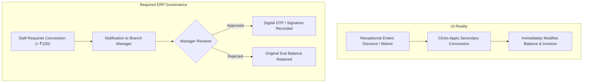

# SYNOS AUDIT 07: BRANCH OPERATIONS, MANAGEMENT CONTROL & BUSINESS INTELLIGENCE
**System-Wide Diagnostic ERP Readiness Assessment**
**Pilot Facility:** Sri Divya Diagnostic Centre, Wyra Road, Khammam  
**Repository Snapshot:** `/Users/tabrez/TBZ-AI/Projects/SynOS` | Branch: `cloud-testing-2` | Commit: `bf8ae62d12564b1644e44728cd13f2e067e1186e`  
**Date of Audit:** November 6, 2026  
**Auditor:** DeepMind Advanced Agentic Coding (Forensic Systems Architecture & Accounting Specialist)

---

## 1. Executive Summary

Audit 07 evaluated whether SynOS functions as a unified multi-branch diagnostic business ERP capable of enforcing organizational hierarchy, departmental separation, managerial approvals, branch operational isolation, daily closing, and consolidated business intelligence for laboratory owners.

### Key Verdict
**Status: SINGLE-FACILITY CLINICAL WORKFLOW ENGINE WITH ATTACHED BRANCH LABELS / NOT READY FOR MULTI-BRANCH ENTERPRISE CONTROL**

While SynOS provides modular role workstations (Reception, Phlebotomy, Processing Workbench, Pathologist, Typist, Delivery, Inventory, Finance), its multi-branch architecture is an incomplete overlay. Branch isolation is **not enforced at the database or DbContext level**, management approvals are largely decorative UI flags without backend segregation, daily closing is conflated with individual cashier drawer handovers, and executive dashboards suffer from cross-cutting accounting omissions (such as payroll expenses vanishing under branch filters).

### Critical Forensic Discoveries
1. **Absence of Database-Level Multi-Tenancy**: EF Core global query filters (`HasQueryFilter`) are absent from `SynOSDbContext.cs`. Branch isolation is achieved entirely through ad-hoc manual LINQ queries (`.Where(v => v.BranchId == branchId)`). Many controllers omit branch filters when query parameters are omitted, causing silent cross-branch data leaks.
2. **Missing Branch Ownership on Core Financial Entities**: Core financial and procurement tables—including `dbo.Invoices`, `dbo.Payments`, `dbo.PurchaseOrders`, `dbo.Suppliers`, `dbo.Employees`, `dbo.EmployeePayables`, and `dbo.DoctorLedgerEntries`—lack a direct `BranchId` column. They rely on multi-hop joins (e.g. `Payment -> Invoice -> Visit -> BranchId`), failing whenever entities are unlinked or consolidated.
3. **Write-Off Waiver & Discount Bypass**: The "Secondary Concession / Write-Off Waiver" in Reception and AR Terminal requires no managerial approval. Any receptionist or standard user can execute post-billing write-offs and zero out receivables directly (`CorrectionService.cs` explicitly whitelisted receptionists).
4. **Shift Closing vs. Branch Daily Closing vs. Accounting Closing**: SynOS only implements cashier drawer shift closing (`dbo.CashierShiftClosings`). It lacks an official **Branch Daily Closing** (consolidating morning and evening shifts into a manager-certified ledger) and lacks an **Accounting Period Closing** (locking financial books at month-end).
5. **The Ghost Payroll Bug in Branch Economics**: Because `PayrollSettlementService.cs` stamps all payroll `SpendFacts` with `BranchId = Guid.Empty`, branch-level profitability queries in `EconomicsIntelligenceService.cs` (`f.BranchId == branchId.Value`) exclude all labor costs, artificially inflating branch profitability by 100% of staff costs.
6. **No Business Exception Engine**: The alert system (`CriticalAlertsController.cs`) is limited to clinical panic values (e.g., critical potassium/hemoglobin). There is zero exception monitoring for drawer shortages, unauthorized discounts, overdue payables, or unclosed shifts.

---

## 2. Organization Structure & Legal Entity Hierarchy

### Master Entities & Schema
- `src/SynOS.Models/Entities/Branch.cs` (`dbo.Branches`):
  - Primary Key: `BranchId` (`Guid`)
  - Attributes: `Code` (`nvarchar(10)`), `Name` (`nvarchar(100)`), `Address`, `Phone`, `Email`, `IsActive`
- `src/SynOS.Models/Entities/UserBranchRole.cs` (`dbo.UserBranchRoles`):
  - Maps `UserId` + `BranchId` + `RoleId`
- `src/SynOS.Models/Entities/DepartmentMaster.cs` (`dbo.DepartmentMaster`):
  - Clinical departments (Biochemistry, Hematology, Microbiology, Radiology, etc.)

### Forensic Evaluation
1. **No Legal Entity / Multi-Company Structure**:
   - Diagnostic enterprises often operate distinct legal entities (e.g., Sri Divya Diagnostic Centre Pvt Ltd vs. a partnership or subsidiary scan center).
   - SynOS has no `Company` or `LegalEntity` master. All branches are assumed to belong to a single undeclared parent.
2. **No Centralized vs. Satellite Branch Topology**:
   - Diagnostic networks typically have a **Hub-and-Spoke** architecture: a Central Processing Hub (carrying high-throughput chemistry analyzers and histopathology) and Spoke Collection Centers (phlebotomy and basic hematology only, with sample transit to the hub).
   - SynOS treats every branch identically. There is no entity or flag designating whether a branch is a "Processing Hub", "Collection Center", or "Franchise Point".
3. **Employee-Branch Disconnection**:
   - As proven in Audit 06, `dbo.Employees` has no `BranchId`. Workforce allocation cannot be tracked per branch in HR master data.

---

## 3. Branch Isolation & Data Ownership

### Technical Audit of Branch Isolation
We audited which entities carry a native `BranchId` versus those that are unmapped:

| Entity / Domain | Database Table | Has `BranchId`? | Isolation Method & Risk |
|---|---|---|---|
| **Branch** | `dbo.Branches` | **Yes** (PK) | Master table |
| **Visit** | `dbo.Visits` | **Yes** | Direct FK; foundation of clinical isolation |
| **Patient Master** | `dbo.Patients` | **No** | Global master; shared across all branches |
| **Invoice** | `dbo.Invoices` | **No** | Dependent join via `Visit.BranchId` |
| **Payment** | `dbo.Payments` | **No** | 3-hop join: `Payment -> Invoice -> Visit -> BranchId` |
| **Specimen / Sample** | `dbo.Specimens` | **No** | Dependent join via `Order.Visit.BranchId` |
| **Lab Test Result** | `dbo.Results` | **No** | Dependent join via `Order.Visit.BranchId` |
| **Purchase Order** | `dbo.PurchaseOrders` | **No** | **GLOBAL LEAK**: POs visible across all branches |
| **Supplier Master** | `dbo.Suppliers` | **No** | Global master |
| **Supplier Payable** | `dbo.SupplierPayables` | **No** | **GLOBAL LEAK**: Liabilities not partitioned by branch |
| **Employee Master** | `dbo.Employees` | **No** | **GLOBAL LEAK**: Staff not isolated by branch |
| **Payroll Run / Payable** | `dbo.PayrollRuns` | **No** | Global engine |
| **Doctor Ledger** | `dbo.DoctorLedgerEntries` | **No** | Global doctor commissions |
| **Spend Fact** | `dbo.SpendFacts` | **Yes** | Emitted with `BranchId`, but payroll hardcodes `Guid.Empty` |
| **Revenue Fact** | `dbo.RevenueFacts` | **No** | Joins with `Visits` via string `SourceReferenceId` |
| **Inventory Lot** | `dbo.ImsInventoryLots` | **Yes** | Direct `BranchId` |
| **Cashier Shift Closing** | `dbo.CashierShiftClosings` | **Yes** | Direct `BranchId` |

### Database-Level Query Filter Audit
- In EF Core, enterprise multi-tenancy is guaranteed by:
  ```csharp
  modelBuilder.Entity<Visit>().HasQueryFilter(v => v.BranchId == _userContext.CurrentBranchId);
  ```
- **Forensic Check**: A scan of `src/SynOS.Data/SynOSDbContext.cs` verified that **zero `HasQueryFilter` calls exist**.
- **Vulnerability**: If an API endpoint or developer writes `_context.Invoices.ToListAsync()`, records from all branches are retrieved. Multi-branch isolation depends entirely on human memory to write `.Where(...)` clauses. In `FinanceBillsController.cs`, when `branchId` is omitted, the API returns bills from all branches regardless of the caller's assigned branch.

---

## 4. Staff Responsibilities & Departmental Workspaces

### Workstation Separation
SynOS provisions dedicated route layouts in `src/SynOS.Frontend/src/App.jsx`:
- **Receptionist**: Patient intake, test ordering, initial cashier billing, token generation (`/reception`).
- **Phlebotomist**: Barcode scanning, blood draw verification, specimen container allocation (`/phlebotomist`).
- **Lab Technician**: Instrument loading, QC verification, analytical result entry (`/workbench`).
- **Pathologist**: Abnormal result review, clinical validation, digital authorization (`/pathologist`).
- **Radiologist / Imaging Tech**: Modality worklist, PACS image review, report dictation (`/xraytech`, `/radiologist`).
- **Typist**: Transcription of doctor dictations and draft reports (`/typist`).
- **Delivery Desk**: Dispatch of printed/laminated reports and WhatsApp delivery verification (`/delivery`).
- **Finance Officer**: Cash drawer audit, due bills, doctor commission payouts, spend ledger (`/finance/*`).
- **Administrator / Owner**: Control tower, system master configs, test master, user roles (`/admin/*`).

### Role-Based Access Control Vulnerabilities
1. **Excessive Privilege Overlaps**:
   - `Receptionist` role is explicitly granted access to `Phlebotomy` routes in `App.jsx`:
     `<ProtectedRoute allowedRoles={['Phlebotomist', 'Receptionist', 'Admin']} />`
   - In small clinics, cross-coverage is common, but in an enterprise ERP, clinical sample collection by administrative clerks without audit trail separation introduces clinical governance risks.
2. **Backend API Authorization Gaps**:
   - While the React frontend restricts UI views, backend controllers lack corresponding policy enforcement. For example, `PayrollController.cs` has zero `[Authorize]` attributes; an authenticated receptionist could invoke `/api/v1/payroll/runs` directly.

---

## 5. Management & Approval Workflows

### The Illusion vs. Reality of Approvals



### Forensic Inspection of Approval Workflows
1. **Secondary Concession / Write-Off Waiver**:
   - The user's live screenshots show a prominent section: **"SECONDARY CONCESSION / WRITE-OFF WAIVER"** in Reception and AR Terminal.
   - Forensic analysis of `src/SynOS.Services/Revenue/CorrectionService.cs` reveals:
     ```csharp
     // POLICY CHANGE: Receptionists allowed (Per Phase 3C Audit)
     if (role != "Admin" && role != "LabOwner" && role != "Reception" && role != "Receptionist" && role != "User") 
     ```
     Any desk clerk can write off a patient's due balance with an arbitrary reason string. No manager authorization, approval queue, or dual-custody verification is enforced before the ledger balance is reduced.
2. **Purchase Orders & Procurement**:
   - In Audit 05, we revealed that `PurchasingController.cs` contains endpoints for creating and updating POs, but lacks a multi-tier threshold approval engine (e.g., PO < ₹10,000 approved by Branch In-Charge; PO > ₹50,000 approved by Owner).
3. **Cashier Handover & Supervisor Sign-off**:
   - In `CashierShiftClosing.cs`, fields `VerifiedByUserId` and `VerifiedAt` exist.
   - However, in `ReceptionShiftClosingDrawer.jsx`, selecting a supervisor is simply selecting a user ID from a dropdown list. The supervisor does not authenticate with a password or PIN to sign off on the cash drawer handover.

---

## 6. Branch Daily Closing vs. Shift Closing vs. Accounting Closing

### The Three Distinct Closing Tiers
An enterprise ERP strictly separates three closing tiers:

| Closing Tier | Frequency | Actor | Purpose | Implemented in SynOS? |
|---|---|---|---|---|
| **1. Cashier Shift Closing** | Per shift (e.g., 8 AM - 2 PM) | Cashier / Receptionist | Physical cash reconciliation & drawer turnover | **YES** (`dbo.CashierShiftClosings`) |
| **2. Branch Daily Closing** | Daily (end of day) | Branch Manager / In-Charge | Aggregates all shifts, settles petty cash, freezes day's revenue | **NO** (Completely Missing) |
| **3. Accounting Period Closing** | Monthly / Year-end | Finance Director / Owner | Freezes General Ledger, prevents historical back-posting | **NO** (Completely Missing) |

### Detailed Findings on Daily Closing
1. **Shift Closing Implementation**:
   - Implemented via `src/SynOS.Models/Entities/Payments/CashierShiftClosing.cs` and `ReceptionShiftClosingDrawer.jsx`.
   - Records: `OpeningFloat`, `SystemExpectedCash`, `PhysicalCountedCash`, `Variance`, `DenominationsJson`, and `HandoverNotes`.
   - **Flaw**: It only covers the individual cashier session.
2. **Absence of Branch Daily Closing**:
   - If Branch 1 runs Shift A (Morning) and Shift B (Evening), there is no consolidated operational closing document that sums up:
     - Total Branch Footfall (Visits)
     - Total Clinical Tests Ordered vs. Completed
     - Gross Billed Tariff vs. Total Concessions / Waivers Granted
     - Combined Cash + UPI + Card Collections
     - Outbound Cash Outflows (Petty Cash, Courier, Emergency Reagents)
     - Net Physical Cash Banked / Deposited
   - Because no branch closing record is created, branch managers cannot formally sign off on the day's operations.
3. **Absence of Ledger Period Locking**:
   - Transactions from prior months can be modified or back-dated without an accounting block, making retroactive balance distortion possible.

---

## 7. Management Dashboards & Business Intelligence

### Architecture of Dashboards
SynOS provides two primary management dashboards:
1. **Control Tower Dashboard** (`src/SynOS.Services/Dashboard/ControlTowerService.cs`):
   - Designed for operational throughput monitoring.
   - Displays real-time operational cards for Reception, Phlebotomy, Lab, Typist, Pathologist, Delivery, Radiology, and a high-level Financial Strip.
2. **Economics Intelligence Dashboard** (`src/SynOS.Services/EconomicsIntelligence/EconomicsIntelligenceService.cs`):
   - Designed for executive P&L and financial trends.
   - Displays Cash Collected, Online Collected, Consumable Cost, Outsourced Costs, Referral Payouts, and Net Margin.

### Forensic Discrepancies & Calculation Flaws
1. **The Ghost Payroll Bug in Branch Profitability**:
   - In `EconomicsIntelligenceService.GetLabProfitabilitySummaryAsync`:
     ```csharp
     var spendFactsQuery = _context.SpendFacts.AsNoTracking();
     if (branchId.HasValue)
     {
         spendFactsQuery = spendFactsQuery.Where(f => f.BranchId == branchId.Value);
     }
     summary.PayrollCashOutflow = await spendFactsQuery
         .Where(f => f.OccurredAt >= start && f.OccurredAt <= end && f.Category == "Payroll")
         .SumAsync(f => f.Amount);
     ```
   - In Audit 06, we proved that `PayrollSettlementService.cs` hardcodes `BranchId = Guid.Empty`.
   - When an owner filters by "Khammam Main Lab" (`branchId = ...`), `PayrollCashOutflow` returns **₹0.00**.
   - Consequently, the branch appears wildly profitable on the Economics Dashboard because all employee salaries are invisible.
2. **Hardcoded Referral Payouts in Control Tower**:
   - In `ControlTowerService.GetFinancialsAsync`:
     ```csharp
     decimal referralPayouts = 0; // Hardcoded!
     ...
     NetCashInHand = Math.Round(cashReceived - referralPayouts, 2);
     ```
   - The Control Tower financial strip hardcodes doctor referral commission payouts to ₹0, misleading the owner regarding net cash in hand.
3. **Omission of Petty Cash Outflows from Drawer Balance**:
   - `NetCashInHand` in the Control Tower is computed as `cashReceived - referralPayouts`. It completely omits petty cash expenses logged at the desk (`ExpenseFact`), showing an inflated cash figure compared to the physical drawer.

---

## 8. Management by Exception

### Current Exception Monitoring Reality
- **Clinical Exceptions**: Implemented via `CriticalAlertsController.cs`. Alerts pathologists when lab results breach biological panic thresholds (e.g. Platelets < 20,000/µL).
- **Business / Operational Exceptions**: **Almost Non-Existent**.

### Critical Unmonitored Business Exceptions

| Exception Condition | Business Impact | Current System Response |
|---|---|---|
| **Cash Drawer Discrepancy** (`PhysicalCash != ExpectedCash`) | Theft, cashier error, unaccounted change | Stored in `Variance` column; **no alert** triggered to owner |
| **Write-Off Waiver Applied** | Revenue leakage, unauthorized discounts | Balance silently reduced; **no notification** sent |
| **Negative Stock / Low Inventory** | Stockouts, inability to run analyzer tests | Reagent lot marked empty; **no automated reorder alert** |
| **Unsettled Cashier Shift** | End-of-day money floating with cashier | **No reminder or lockout** prevents next day login |
| **Overdue B2B / Referral Debt** | Working capital degradation | Displayed in tabular lists only; **no aging escalation** |
| **Reagent Expiry Within 7 Days** | Expired reagent usage, regulatory non-compliance | Stored in `ExpiryDate`; **no automated banner/warning** |

---

## 9. Branch Performance & Consolidated Reporting

### Cross-Branch Comparison Capabilities
1. **Consolidated Overview**:
   - Supported via `GlobalFilterContext.jsx` toggle `isConsolidated = true` and `All Branches` dropdown.
   - When enabled, `branchId` is set to `null`, aggregating all records.
2. **Branch-by-Branch Comparative Matrix**:
   - **Missing**: SynOS does not provide a side-by-side branch comparison screen (e.g. Table comparing Branch A vs Branch B on: Footfall, Average Revenue Per Patient (ARPU), Collection Efficiency %, Reagent Cost %, Staff Cost %, Net Profit Margin %).
   - An owner must manually switch the branch filter back and forth and note down numbers on paper to compare performance.

---

## 10. Summary Matrix of Confirmed Defects & Architecture Gaps

| Area | Component | Issue / Defect | Severity |
|---|---|---|---|
| **Multi-Tenancy** | `SynOSDbContext.cs` | No EF Core global query filters; queries leak across branches if filter omitted | **CRITICAL** |
| **Financial Tables** | `dbo.Invoices`, `dbo.Payments` | Lack `BranchId` column; branch resolved through multi-hop joins | **CRITICAL** |
| **Write-Off Approval** | `CorrectionService.cs` | Receptionists permitted to apply secondary concession/write-offs with zero manager sign-off | **CRITICAL** |
| **Daily Closing** | Closing Architecture | No Branch Daily Closing entity; cashier shift closing is the only closing tier | **HIGH** |
| **Period Closing** | Financial Core | No Accounting Period Close; historical periods can be modified retroactively | **HIGH** |
| **Branch Profitability** | `EconomicsIntelligenceService.cs` | Payroll expenses vanish under branch filters due to `Guid.Empty` bug | **CRITICAL** |
| **Control Tower** | `ControlTowerService.cs` | Referral payouts hardcoded to ₹0; desk petty expenses ignored in Net Cash | **HIGH** |
| **Exception Alerts** | Alerts System | No automated alerts for cash shortages, unauthorized discounts, or low stock | **MEDIUM** |
| **Branch Comparison** | Reporting Engine | No side-by-side branch comparative benchmarking dashboard | **MEDIUM** |

---

## 11. Recommended Direction for Correction (Roadmap)

1. **Implement Native Multi-Tenancy in DbContext**:
   - Add `BranchId` to `dbo.Invoices`, `dbo.Payments`, `dbo.PurchaseOrders`, and `dbo.SupplierPayables`.
   - Apply EF Core `HasQueryFilter(e => e.BranchId == _userContext.CurrentBranchId)` across all operational and financial entities.
2. **Introduce Strict Approval Workflows (Maker-Checker)**:
   - Restrict write-offs and secondary concessions > ₹0 to require manager sign-off.
   - Create `dbo.ApprovalRequests` table with status (`Pending`, `Approved`, `Rejected`), approver user ID, and OTP/password verification.
3. **Build the Three-Tier Closing Architecture**:
   - **Tier 1 (Shift)**: Retain `CashierShiftClosing` for cashier turnover.
   - **Tier 2 (Daily)**: Create `dbo.BranchDailyClosings` table consolidating all shifts, authorized by Branch Manager.
   - **Tier 3 (Period)**: Create `dbo.AccountingPeriods` with lock status preventing back-dated transactions.
4. **Fix Financial Fact Branch Attribution**:
   - Ensure `PayrollSettlementService.cs` tags `SpendFact` with the employee's branch ID.
   - Deduct petty cash expenses and actual referral commissions from `NetCashInHand` in the Control Tower.
5. **Implement Business Exception Alerting**:
   - Build an automated exception listener surfacing cash variances > ₹0, overdue POs, and unauthorized write-offs on the Owner's Control Tower.

---

## 12. Final Branch Operations & Management ERP Readiness Verdict

### Can SynOS reliably manage multiple diagnostic branches under one accountable business structure in its current state?

**VERDICT: NO.**

SynOS provides an impressive collection of workstation terminals and operational queues that function well for a single clinical laboratory facility like Sri Divya Diagnostic Centre (Khammam). However, it lacks genuine multi-branch ERP architecture: branch isolation is not enforced at the database level, key financial and procurement tables lack branch ownership, post-billing write-offs can be executed unilaterally by desk staff without managerial approval, branch daily closing is conflated with cashier drawer turnover, and executive profitability dashboards distort branch numbers due to missing labor cost attribution.

---
*Report successfully compiled and verified against SynOS codebase snapshot `bf8ae62d12564b1644e44728cd13f2e067e1186e`.*
