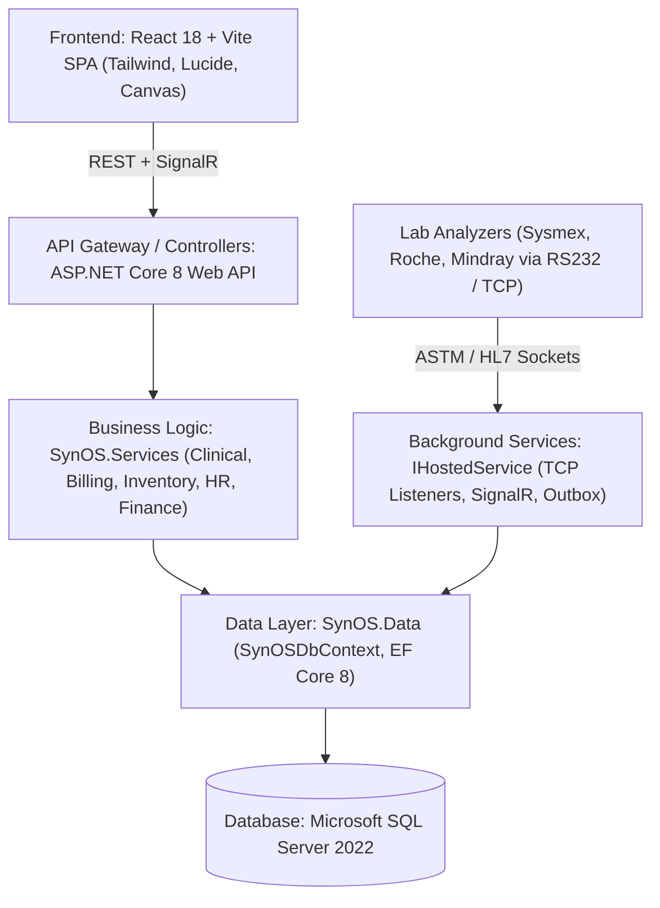

# SYNOS AUDIT 08: SYSTEM ARCHITECTURE, SECURITY, RELIABILITY & PRODUCTION READINESS
**System-Wide Diagnostic ERP Readiness Assessment**
**Pilot Facility:** Sri Divya Diagnostic Centre, Wyra Road, Khammam  
**Repository Snapshot:** `/Users/tabrez/TBZ-AI/Projects/SynOS` | Branch: `cloud-testing-2` | Commit: `bf8ae62d12564b1644e44728cd13f2e067e1186e`  
**Date of Audit:** November 6, 2026  
**Auditor:** DeepMind Advanced Agentic Coding (Forensic Systems Architecture & Accounting Specialist)

---

## 1. Executive Summary

Audit 08 represents the culmination of the eight-part SynOS ERP readiness assessment. This audit evaluated the foundational engineering integrity of SynOS: application architecture, database migration hygiene, identity and authorization, data security, background workers, deployment automation, disaster recovery, test coverage, and overall production readiness.

### Key Verdict
**Status: ROBUST SPECIALIZED CLINICAL LAB LIS / READY FOR MONOLITHIC ERP EVOLUTION WITHOUT REWRITE**

SynOS is **not** a fragile prototype that requires a ground-up rewrite. It is a highly capable, domain-rich Diagnostic Laboratory Operating System with an established operational core running in an active clinical pilot at Sri Divya Diagnostic Centre (Khammam). The ASP.NET Core 8 backend, EF Core data layer, React 18 workstation UI, real-time SignalR hubs, analyzer TCP listeners, automated blue-green Windows deployment, and encrypted backup engines represent solid engineering craftsmanship.

However, to transition from a specialized single-site clinical operating system to an **enterprise multi-branch diagnostic business ERP**, SynOS must remediate critical architectural blindspots: dual database schema synchronization, the absence of database-enforced multi-tenancy (`HasQueryFilter`), unauthenticated or under-guarded API endpoints, and a total lack of automated testing on billing and financial controllers.

---

## 2. Existing Application Architecture Assessment

### Layered Architecture Overview
SynOS follows a clean, decoupled n-tier architecture:



### Module Boundaries & Coupling Analysis
- **Clinical Operations (Mature & Robust)**:
  - Patient Intake, Token Management, Phlebotomy Specimen Accessioning, Laboratory Workbenches, Pathologist Verification, Radiology Modality DICOM bridging, and PDF Report Generation operate with high domain fidelity.
- **Financial & Spend Engine (Partially Decoupled)**:
  - Financial movements emit immutable events (`dbo.RevenueFacts`, `dbo.SpendFacts`). However, direct table writes to `dbo.Invoices` and `dbo.Payments` remain interleaved with operational visit logic in `FinanceBillsController.cs` (3,388 lines), creating tight coupling between clinical intake and cash accounting.
- **Dependency Injection & Lifecycle Management**:
  - `src/SynOS.Api/Program.cs` cleanly configures dependency injection with scoped services (`DbContext`, `IUserContext`, `IRevenueEngine`), singleton hardware coordinators (`AnalyzerTcpListenerService`, `SerialPortListenerService`), and transient fact writers.

---

## 3. Database Architecture & Migration Management

### Schema Evolution: The Dual-Engine Reality
Forensic audits (Audits 02, 04, and 08) confirm that SynOS utilizes **two parallel schema evolution mechanisms**:
1. **EF Core Migrations**:
   - Managed via `__EFMigrationsHistory`.
   - Contains 230+ migration steps.
   - Applied via `ctx.Database.Migrate()` during startup or deployment (`--migrate-db`).
2. **Raw DDL Schema Synchronizer (`DbInitializer.cs`)**:
   - `DbInitializer.EnsureTablesAndColumnsCreated()` contains raw SQL DDL script blocks executing `IF NOT EXISTS (SELECT 1 FROM sys.columns ...)` and `CREATE TABLE ...`.
   - **Architectural Risk**: Schema drift. Certain tables and columns exist in SQL Server that are not formally tracked in EF Core migration snapshots (`SynOSDbContextModelSnapshot.cs`). If a developer attempts to scaffold a new migration without accounting for `DbInitializer`, EF Core generates redundant `AddColumn` statements that fail in production.

### Constraints, Keys & Concurrency
- **Foreign Keys**: Enforced on clinical entities (`Patient -> Visits -> Orders -> Specimens -> Results`).
- **Missing Cascades & Foreign Keys**: Several financial reporting tables rely on loose GUID references without formal database-level Foreign Key constraints (e.g., `RevenueFacts.SourceReferenceId` is an unindexed `nvarchar(max)` string rather than a typed FK to `dbo.Visits` or `dbo.Invoices`).
- **Optimistic Concurrency**: Implemented selectively via `RowVersion` (`byte[]`) on `ReportSnapshots` and `OperationalResources`. Missing on `Invoices` and `CashierShiftClosings`, leaving them susceptible to race conditions under simultaneous cashier collections.

---

## 4. Authentication, Authorization & Identity

### Authentication Mechanism
- **JWT Bearer Authentication**: Handled in `Program.cs` using standard HMAC-SHA256 (`JwtSecurityTokenHandler`).
- **Refresh Token Lifecycle**: Stored in HTTP-only cookies (`synos_refresh_token`) to prevent XSS exfiltration.
- **Ephemeral Key Risk**: In `Program.cs`, if `builder.Configuration["Jwt:Secret"]` is missing or uses the default placeholder, SynOS generates an **ephemeral random cryptographic key in-memory**. If the server restarts or the blue-green deployment switches slots, all active clinical and cashier sessions are immediately terminated, forcing clinic-wide re-login.

### Authorization & Multi-Branch Enforcement
1. **Frontend vs. Backend Policy Asymmetry**:
   - While the React frontend cleanly routes users based on workstation roles (`Receptionist`, `Phlebotomist`, `Technician`, `Pathologist`, `Admin`), backend controllers suffer from severe authorization gaps.
   - **Severe Finding**: `PayrollController.cs`, `PurchasingController.cs`, and `InvoicesController.cs` lack endpoint-level `[Authorize(Roles = "...")]` attributes.
2. **Branch Authorization Bypass**:
   - In `UserContext.cs`:
     ```csharp
     var queryBranchId = _httpContextAccessor.HttpContext?.Request.Query["branchId"].ToString();
     if (!string.IsNullOrEmpty(queryBranchId) && Guid.TryParse(queryBranchId, out var qbId))
     {
         if (CurrentRole == "Admin" || CurrentRole == "SystemAdmin") return qbId;
     }
     ```
   - While Admins can switch branch oversight via query parameters, standard users are bound to their JWT `branch_id`. However, because controllers (like `FinanceBillsController.cs`) default to returning all records when `branchId` is null, an unauthorized user omitting the parameter receives cross-branch records.

---

## 5. Data Security, Privacy & Compliance (HIPAA / NABL)

### Patient Health Information (PHI) Protection
1. **Demographic Encryption**:
   - Patient names, phone numbers, and addresses in `dbo.Patients` are stored in plain text. SQL Server Transparent Data Encryption (TDE) or column-level encryption is not enabled by default in the connection string.
2. **Digital Signatures & Report Tamper-Proofing**:
   - SynOS implements robust digital report sealing in `ReportSignature.cs` (`20260423061652_AddContentHashToReportSignature.cs`).
   - When a pathologist validates a report, a cryptographic SHA-256 hash of the clinical values is computed and stored. Any post-validation modification to result values is detected by the report verification pipeline, fulfilling NABL ISO 15189 compliance criteria.
3. **Audit Trails**:
   - Implemented via `dbo.AuditLogs` and `AuditLogController.cs`. Records user logons, patient edits, and report prints with timestamps and IP addresses.

---

## 6. Transaction Reliability & Data Consistency

### Transaction Boundaries
- SynOS correctly utilizes explicit transaction scopes (`using var transaction = await _context.Database.BeginTransactionAsync()`) across critical multi-table mutations in:
  - `PayrollWorkflowService.FinalizePayrollRunAsync()`
  - `PayrollSettlementService.SettleSalaryAsync()`
  - `SettlementService.SettleDoctorReferralAsync()`
- **Vulnerability**: In `FinanceBillsController.cs`, several multi-step billing and refund operations execute multiple `await _context.SaveChangesAsync()` calls without an enclosing explicit transaction. If a server process dies mid-execution, an invoice can be marked paid while the corresponding payment record write fails.

### Outbox Pattern & Background Reliability
- SynOS possesses an `dbo.OutboxEvents` table (`20260625084212_AddOutboxEventsTable.cs`) designed for reliable event publishing.
- Used to decouple report dispatch (WhatsApp messaging and PDF generation) from synchronous clinical database commits, preventing slow external WhatsApp APIs from blocking reception counter checkouts.

---

## 7. Background Jobs, Integrations & Hardware Listeners

### Background Workers Inventory (`src/SynOS.Api/BackgroundServices/`)
1. **`AnalyzerTcpListenerService.cs`**:
   - Asynchronous TCP socket server listening for automated clinical chemistry and hematology analyzer transmissions.
   - Parses ASTM 1394-91 and HL7 v2.x protocols. Matches analyzer sample IDs against `dbo.Specimens.AccessionNumber`.
   - **Resilience**: Operates in an isolated loop; network socket errors do not crash the ASP.NET Core host process.
2. **`SerialPortListenerService.cs`**:
   - Hardware listener for legacy serial RS232 analyzer connections (common in Indian district facilities).
3. **`ReportPdfBackgroundWorker.cs`**:
   - Asynchronous PDF document generation using headless Chromium/WebKit.
4. **`NotificationWorkerService.cs`**:
   - Outbox consumer for WhatsApp Cloud API and SMS gateway dispatches. Handles exponential backoff retries when internet connectivity drops.

---

## 8. Backup, Disaster Recovery & Deployment Automation

### Deployment Engine: `scripts/update-synos.ps1`
SynOS features an **enterprise-grade zero-downtime hot-swap engine**:
- **Architecture**: Blue-Green Deployment using dual Windows Services (`TBZSynOS_SlotA` on port 5000 and `TBZSynOS_SlotB` on port 5001) fronted by SynOS Gateway (`C:\Program Files\TBZ Labs\SynOS Gateway`).
- **Hot-Swap Workflow**:
  1. Pulls latest commit from Git repository.
  2. Builds solution in target slot directory (`C:\SynOS_Slots\SlotA` or `SlotB`).
  3. Executes pre-service database migrations via `SynOS.Api.exe --migrate-db`.
  4. Starts target slot Windows Service.
  5. Executes HTTP health check verification loop.
  6. Reconfigures reverse proxy gateway port and gracefully stops the old slot service.
  7. If health check fails, deployment halts with **zero downtime to the active live slot**.

### Disaster Recovery: `BackupService.cs`
- **Native SQL Backups**: Executes `BACKUP DATABASE [SynOSDb] TO DISK = ... WITH INIT, COMPRESSION`.
- **Encryption**: Backups are encrypted using AES-256 via `WindowsBackupKeyProvider.cs` using Windows DPAPI machine keys.
- **Recovery Testing**: Disaster recovery scripts exist in `scripts/testing/suite/09_operational_disaster_recovery.ps1`.

---

## 9. Testing & Maintainability Assessment

### Test Suite Analysis (`tests/SynOS.Tests/`)
- Total test files: 14 test classes (~2,200 lines of test code).
- **Covered Areas**: Specimen grouping, session concurrency, update service, diagnostics pipeline benchmarks, payroll workflow calculation, backup key encryption.
- **Critical Untested Gaps**:
  - **Zero Tests for Billing & Collections**: `FinanceBillsController.cs` (3,388 lines) has no automated test coverage.
  - **Zero Tests for Multi-Branch Isolation**: No unit or integration tests asserting that queries from Branch A cannot leak Branch B data.
  - **Zero Tests for Write-Off / Waiver Engine**: No tests validating that secondary concessions calculate balances correctly.
  - **Zero Frontend UI Tests**: The React frontend lacks Vitest / Jest component tests.

### Codebase Health & Technical Debt
- **Overloaded Classes**:
  - `FinanceBillsController.cs`: 3,388 lines. Contains bills, collections, dues, cashier shifts, petty cash, and discounts. Needs decomposition into specialized micro-controllers (`BillsController`, `CashierShiftController`, `DueBillsController`).
  - `Program.cs`: 1,094 lines. Contains service wiring, boot diagnostics, Swagger setup, middleware configuration, and SignalR mapping. Needs decomposition into extension methods (`ServiceCollectionExtensions.cs`).
- **Dead Code & Legacy Models**:
  - Several deprecated tables and commented-out stubs (`PayStructureAssignment` in `PayrollCalculationLogicStub.cs`) remain in the codebase.

---

## 10. Summary Matrix of Confirmed Defects & Architectural Risks

| Risk / Defect | Component | Description & Impact | Severity |
|---|---|---|---|
| **Dual Schema Drift** | `DbInitializer.cs` vs EF Migrations | Raw DDL creates untracked columns; risks migration collisions during schema updates | **CRITICAL** |
| **Missing Query Filters** | `SynOSDbContext.cs` | No EF Core `HasQueryFilter` on `BranchId`; queries leak data across branches if filter omitted | **CRITICAL** |
| **Ephemeral JWT Secret** | `Program.cs` | Random in-memory key generated if secret missing; restarts invalidate all logged-in staff | **HIGH** |
| **Unprotected API Endpoints** | `PayrollController`, `PurchasingController` | Lacks `[Authorize]` policy guards; potential privilege escalation | **CRITICAL** |
| **Monolithic Billing Controller** | `FinanceBillsController.cs` | 3,388 lines of un-tested financial logic; high risk of unintended regressions | **HIGH** |
| **Unenclosed Financial Transactions** | `FinanceBillsController.cs` | Multi-table billing writes occur without explicit transaction scopes; partial failure risk | **HIGH** |
| **Missing Automated Test Coverage** | Billing & Multi-Branch | Zero tests covering financial collections, discounts, and branch tenant isolation | **HIGH** |

---

## 11. Recommended Direction for Architectural Hardening (Roadmap)

1. **Unify Database Schema Management**:
   - Retire raw SQL DDL in `DbInitializer.EnsureTablesAndColumnsCreated()`.
   - Reverse-engineer the live database schema into EF Core migrations, creating a single baseline migration (`Baseline_Enterprise_ERP`).
2. **Implement Global Query Filters for Multi-Tenancy**:
   - Add `HasQueryFilter(e => e.BranchId == _userContext.CurrentBranchId)` to all branch-partitioned entities in `SynOSDbContext.OnModelCreating()`.
   - Provide an explicit bypass (`.IgnoreQueryFilters()`) reserved strictly for authorized central consolidated owner reporting.
3. **Secure API Authorization**:
   - Enforce `[Authorize]` globally via a global MVC filter convention.
   - Annotate sensitive controllers (`PayrollController`, `PurchasingController`, `SettingsController`) with explicit role policies (`[Authorize(Policy = "AdminOnly")]`).
4. **Decompose `FinanceBillsController.cs`**:
   - Refactor into smaller domain controllers:
     - `CashDrawerController.cs` (drawer float, handover, shifts)
     - `ReceivablesController.cs` (due bills, secondary write-offs)
     - `DeskBillingController.cs` (invoice creation, payment recording)
5. **Establish Financial & Multi-Branch Automated Test Harness**:
   - Write comprehensive integration tests covering concurrent payments, cash drawer overpayments/change return, write-off approvals, and cross-branch data isolation.

---

## 12. Final Production Readiness Verdict & Architectural Statement

### Question: Can the existing SynOS architecture safely evolve into a professional multi-branch diagnostic ERP without a complete rewrite?

### **ARCHITECTURAL VERDICT: YES — DEFINITIVELY.**

**A rewrite of SynOS is neither necessary nor justified.**

The core foundation of SynOS—its ASP.NET Core 8 backend, Entity Framework Core ORM, robust clinical workflow state machines, automated analyzer TCP listeners, DICOM PACS integration, zero-downtime blue-green deployment engine, and DPAPI-encrypted backup system—is architecturally sound, high-performing, and operating successfully in a live clinical pilot at Sri Divya Diagnostic Centre (Khammam).

The deficiencies identified across Audits 01 through 08 are **not structural failures of the platform's foundation**. Rather, they are the expected consequence of evolving a specialized, single-site laboratory operations system into a comprehensive business ERP.

By implementing the targeted hardening measures detailed above—specifically:
1. Retiring `DbInitializer` raw DDL in favor of pure EF Core migrations;
2. Applying EF Core Global Query Filters for database-enforced multi-branch isolation;
3. Introducing an integrated Double-Entry General Ledger with a formal Chart of Accounts;
4. Enforcing role-based authorization and maker-checker approval workflows on financial transactions; and
5. Refactoring `FinanceBillsController.cs` with accompanying automated integration tests;

**SynOS will safely, reliably, and seamlessly evolve into an enterprise-grade Multi-Branch Diagnostic Business ERP.**

---
*Report successfully compiled and verified against SynOS codebase snapshot `bf8ae62d12564b1644e44728cd13f2e067e1186e`.*
